# GUÍA COMPLETA: despliega Safari Marketplace en tu propio dominio

Esta guía te lleva **desde cero** hasta tener la tienda, el panel de administración
y tu panel de despliegue funcionando en internet, con HTTPS y usando **tus propias
imágenes de Docker**.

No hace falta saber Docker, Dokploy ni DNS de antemano: cada concepto se explica
cuando aparece. Al final tendrás tres direcciones públicas:

```text
https://tienda.<tu-dominio>   → la tienda
https://admin.<tu-dominio>    → el panel de administración
https://dokploy.<tu-dominio>  → tu panel de despliegue
```

Y este recorrido completo:

```text
tu fork (GitHub) ──CI──▶ tus imágenes (Docker Hub) ──▶ Dokploy en tu VM (Azure)
                                                        ▲
                         tu dominio (Cloudflare) ───────┘ DNS
```

| Dato | Valor |
|---|---|
| Tiempo total | 3 a 4 horas, repartidas. Hay esperas: el primer CI tarda 10–15 minutos y el DNS puede tardar en propagarse |
| Costo | El dominio se paga por año. La VM usa el crédito de Azure for Students (USD 100) |
| Resultado | Tienda y admin con candado válido, tu propio CI y tu propio servidor |

> **Reglas de seguridad desde el primer minuto.** Nunca publiques en el
> repositorio, en una captura, en un issue ni en un chat: el token de Docker Hub,
> la llave `.pem`, los secretos de Dokploy (`JWT_SECRET`, `SHOP_SECRET`,
> `POSTGRES_PASSWORD`) ni tus contraseñas. Si compartes una captura del portal de
> Azure, tapa la IP, el *Subscription ID* y cualquier dato personal.

---

## Índice

- [Cómo usar esta guía](#cómo-usar-esta-guía)
- [1. Fundamentos mínimos](#1-fundamentos-mínimos)
- [2. Tu equipo, tus cuentas y tu hoja de datos](#2-tu-equipo-tus-cuentas-y-tu-hoja-de-datos)
- [3. Fase 1. Fork, GitHub Actions y Docker Hub](#3-fase-1-fork-github-actions-y-docker-hub)
- [4. Fase 2. Cloudflare: cuenta y dominio](#4-fase-2-cloudflare-cuenta-y-dominio)
- [5. Fase 3. Azure for Students y la máquina virtual](#5-fase-3-azure-for-students-y-la-máquina-virtual)
- [6. Fase 4. DNS: apuntar el dominio a la VM](#6-fase-4-dns-apuntar-el-dominio-a-la-vm)
- [7. Fase 5. Desplegar con Dokploy](#7-fase-5-desplegar-con-dokploy)
- [8. Fase 6. Operar, actualizar y cerrar](#8-fase-6-operar-actualizar-y-cerrar)
- [Apéndices](#apéndices)

---

## Cómo usar esta guía

### Convenciones

| Escribo | Significa |
|---|---|
| `<tu-usuario>` | Tu usuario de GitHub, y también tu usuario de Docker Hub si usas el mismo |
| `<tu-dominio>` | El dominio que compraste, sin `https://` y sin `/` final. Ejemplo: `ana-lab.dev` |
| `<IP-de-la-VM>` | La IP pública de tu servidor. Ejemplo: `203.0.113.10` |
| `<IMAGE_TAG>` | La etiqueta de la versión a desplegar. Ejemplo: `sha-4fcb7f1` |
| `tienda.<tu-dominio>` | El subdominio real. Ejemplo: `tienda.ana-lab.dev` |

Los comandos son de **bash**: en Windows usa **Git Bash** (viene con Git for
Windows) o **WSL**. Los bloques con `powershell` se ejecutan en PowerShell.

### Cómo están escritas las evidencias

La guía pide **40 capturas en total**. Las **19 primeras** (01–19) ya están
puestas en `img/guia/`; solo faltan las **21 restantes** (20–40). Cada una tiene
un bloque como este:

```markdown
> **📷 EVIDENCIA XX — Título de la captura**
>
> 
>
> *Qué debe verse:* lo que tiene que aparecer en la imagen.
```

En el [apéndice D](#d-índice-de-evidencias) está la lista completa. Si alguna no
se puede capturar, prioriza las del checklist final (apéndice A): son las que
demuestran el resultado.

### Orden y dependencias

| Fase | Qué haces | Lista cuando… |
|---|---|---|
| 1. Fork y CI | Creas tu fork, habilitas Actions, conectas Docker Hub y publicas tus imágenes | Hay una corrida verde de `main` con el job **«Imágenes Docker · build y publicación»** y anotaste su `IMAGE_TAG` |
| 2. Dominio | Creas la cuenta de Cloudflare y compras el dominio | El dominio aparece en tu cuenta de Cloudflare |
| 3. Servidor | Activas Azure for Students, creas la VM, abres puertos y entras por SSH | `ssh` funciona y anotaste la IP |
| 4. DNS | Creas los registros `tienda`, `admin` y `dokploy` | `nslookup tienda.<tu-dominio>` devuelve la IP de tu VM |
| 5. Despliegue | Instalas Dokploy, creas proyecto y Compose, cargas variables y dominios, despliegas y cambias las contraseñas demo | La tienda abre con candado válido y el admin ya no acepta `demodemo` |
| 6. Operar | Actualizas, vuelves atrás, resuelves problemas y controlas el costo | Sabes publicar una versión nueva y apagar o borrar sin sorpresas |

Las fases **1, 2 y 3 son independientes**: puedes dejar corriendo el CI mientras
compras el dominio o creas la VM. La **4** necesita el dominio y la IP; la **5**
necesita todo lo anterior.

### Alternativas rápidas

- **Ya tienes un dominio en otro proveedor:** sáltate la compra y crea los
  registros DNS allí en la fase 4. Los valores son los mismos.
- **Ya tienes un VPS en otro proveedor:** sáltate la fase 3 y revisa los
  requisitos en la sección 7.1. No sirve un VPS ARM.
- **El curso lo hace en grupo:** acuerden quién compra el dominio y en qué cuenta
  queda. El dueño de la cuenta es el dueño del dominio.

---

## 1. Fundamentos mínimos

Esta sección no tiene pasos: es el vocabulario que necesitas para entender el
resto. Si algo te suena, puedes volver aquí cuando aparezca.

### 1.1 Qué es Safari Marketplace

Safari es un **monorepo didáctico**: una tienda de tecnología con su panel de
administración, una API, una base de datos compartida y un scraper que trae
productos de seis tiendas colombianas.

| Pieza | Qué hace | Dónde vive |
|---|---|---|
| Tienda | El sitio público: catálogo, carrito, checkout y cuentas | `apps/shop` |
| Admin | Panel para administradores, dueños de tienda y su staff | `apps/admin/rest` |
| API | REST con autenticación JWT y permisos por rol | `apps/api/rest` |
| Base de datos | PostgreSQL con el catálogo, usuarios, órdenes y contenido | `packages/db`, `db` |
| `db-init` | Aplica el esquema y los datos iniciales; termina y se apaga | `docker/db-init.Dockerfile` |
| `proxy` | Caddy: reparte el tráfico entre tienda, admin y API, y balancea la API | `docker` |
| Scraper | Seis spiders que escriben productos en la misma base | `services/scraper-worker` |

La tienda y el admin parten de la plantilla Pickbazar, adaptada para leer de
PostgreSQL en lugar de datos de prueba.

### 1.2 Fork, commit, rama `main` y CI

- **Repositorio:** el código del proyecto, con su historial.
- **Fork:** *tu* copia del repositorio en *tu* cuenta de GitHub. Ahí trabajas y
  desde ahí se construyen *tus* imágenes.
- **Commit:** una fotografía del código, identificada con un hash como
  `4fcb7f1...`.
- **Rama `main`:** la rama principal. El CI corre en cada push a `main` y en cada
  Pull Request.
- **CI (Integración Continua):** un robot que, en cada cambio, instala, revisa y
  prueba el código. Aquí además construye imágenes de Docker.
- **CD (Despliegue Continuo):** en este proyecto el despliegue **no** es
  automático: tú eliges cuándo y qué versión, cambiando `IMAGE_TAG` en Dokploy.

> **El fork tiene que ser público.** Dokploy lo clona en cada despliegue sin
> credenciales. Un fork de un repositorio público ya nace público: no lo cambies
> a privado.

### 1.3 Imágenes de Docker y Docker Hub

Una **imagen** es un paquete con el sistema de archivos y el comando de arranque
de una aplicación. Un **contenedor** es esa imagen ejecutándose.

El **registro** es donde se guardan las imágenes. Aquí usamos **Docker Hub**:
tu CI publica allí y tu servidor las descarga. No se compila nada en el VPS.

Cada push a `main` produce cinco imágenes, todas con la **misma etiqueta**:

```text
<usuario>/safari-api:sha-4fcb7f1
<usuario>/safari-shop:sha-4fcb7f1
<usuario>/safari-admin:sha-4fcb7f1
<usuario>/safari-db-init:sha-4fcb7f1
<usuario>/safari-proxy:sha-4fcb7f1
```

- La etiqueta es `sha-` más los **7 primeros caracteres del commit**. Por eso se
  despliega siempre un commit concreto y volver atrás es cambiar la etiqueta.
- **No hay `latest`.** Nunca despliegas «lo último» sin saber qué es.
- Son solo **`linux/amd64`**. Un VPS ARM no sirve.
- Cada imagen lleva la etiqueta `org.opencontainers.image.revision` con el
  commit; la API lo devuelve en `/backend/health`.

### 1.4 VPS, IP pública y SSH

Un **VPS** es una máquina virtual Linux en la nube. Aquí corre Dokploy y, dentro
de Docker, todo el stack.

- **IP pública:** la dirección de tu VM en internet. En Azure es **estática**: no
  cambia al detener y arrancar la VM.
- **SSH:** el protocolo con el que entras a la VM por terminal.
- **Llave SSH:** un par de archivos. La **pública** queda en la VM y la
  **privada** (`.pem`) se queda contigo. Es la única forma de entrar; la VM no
  acepta contraseñas.

Requisitos del servidor:

| Recurso | Mínimo | Recomendado aquí |
|---|---|---|
| Arquitectura | `x86_64` / `amd64` | `x86_64` |
| RAM | 2 GB | 4 GB (`Standard B2s`) |
| Disco | 30 GB | 64 GB |
| Sistema | Linux reciente | Ubuntu Server 24.04 LTS |
| Puertos | 80, 443 y 3000 libres | 22, 80, 443 y 3000 abiertos |

### 1.5 DNS: cómo un dominio llega a tu VM

El **DNS** traduce nombres a direcciones IP. Un **registro A** dice «este nombre
apunta a esta IPv4».

```text
navegador ──▶ DNS de Cloudflare ──▶ tienda.<tu-dominio>  ─┐
              (registros A)         admin.<tu-dominio>   ─┼─▶ IP de tu VPS
                                    dokploy.<tu-dominio> ─┘
```

- **Subdominio:** `tienda` en `tienda.ana-lab.dev`. En el panel DNS se escribe
  solo `tienda`; el proveedor agrega el dominio.
- **TTL:** cuánto tiempo los resolvers guardan la respuesta. `Auto` está bien.
- **DNS only (nube gris) vs Proxied (nube naranja):** al principio usamos **DNS
  only**, para que el navegador llegue directo a tu VM y Let's Encrypt emita los
  certificados sin intermediarios. El proxy de Cloudflare es opcional y se activa
  al final, cuando todo funcione.
- Los **tres subdominios apuntan a la misma IP**. Es Traefik, dentro de Dokploy,
  el que decide a qué aplicación va cada uno según el nombre del host.

### 1.6 HTTPS, Let's Encrypt, Traefik y Caddy

- **HTTPS** cifra la conexión. El candado del navegador indica que el certificado
  es válido.
- **Let's Encrypt** es una autoridad que emite certificados gratis. Dokploy los
  pide y los renueva automáticamente.
- **Traefik** es el reverse proxy de Dokploy: recibe el tráfico de internet en
  80/443, termina el HTTPS y enruta según el dominio.
- **Caddy** es el proxy del stack de Safari. Traefik le manda `tienda` y `admin`,
  y Caddy reparte: páginas al frontend y `/backend/*` a la API.

```text
Internet ──https──▶ Traefik (Dokploy)
                        │  tienda.<dominio> ─▶ proxy:3003 ─▶ shop
                        │  admin.<dominio>  ─▶ proxy:3002 ─▶ admin
                        │            /backend/* ─▶ api-lb:9001 ─▶ api ─▶ postgres
```

**No crees un dominio para la API.** El navegador le habla por `/backend/…` dentro
del mismo dominio de la tienda o del admin, y el proxy la envía a `api-lb`.

### 1.7 Qué es Dokploy

Dokploy es un panel de despliegue que se instala en tu VPS. Sobre Docker y
Traefik te permite:

- crear **proyectos** y servicios;
- desplegar un **Compose** desde un repositorio Git;
- cargar **variables de entorno** sin escribirlas en el repo;
- asignar **dominios** y emitir certificados;
- ver **logs**, contenedores y despliegues;
- volver atrás cambiando una etiqueta.

El stack se levanta desde `docker-compose.deploy.yml`, que usa las imágenes de tu
Docker Hub y **no compila nada** en el servidor.

### 1.8 Orden de arranque del stack

```text
postgres (sano) ─▶ db-init (termina) ─▶ api (sana) ─┬─▶ shop  ─┬─▶ proxy
                                                     └─▶ admin ─┘
```

`api-lb` arranca en paralelo. Cada servicio espera al anterior; por eso el primer
despliegue tarda unos minutos.

---

## 2. Tu equipo, tus cuentas y tu hoja de datos

### 2.1 Requisitos en tu equipo

- Un navegador actualizado.
- Una terminal con `ssh`, `curl`, `nslookup` y `openssl`.
- En Windows: **Git Bash** o **WSL**. Los comandos de esta guía son de bash.

Comprueba las herramientas:

```bash
ssh -V
curl --version
nslookup localhost
openssl version
```

Si `openssl` no aparece en Git Bash, ejecuta los comandos de generación de
secretos en la propia VM por SSH: Ubuntu lo trae instalado.

### 2.2 Cuentas que vas a crear

| Cuenta | Para qué | Costo | Dónde |
|---|---|---|---|
| GitHub | Tu fork, el CI y los secretos | Gratis | https://github.com/signup |
| Docker Hub | Guardar tus cinco imágenes | Gratis con repositorios públicos | https://hub.docker.com/signup |
| Cloudflare | Comprar el dominio y manejar su DNS | El dominio se paga por año | https://dash.cloudflare.com/sign-up |
| Azure for Students | La máquina virtual | USD 100 de crédito, sin tarjeta | https://azure.microsoft.com/free/students |

> **El usuario de Docker Hub no se puede cambiar después.** Elige bien: será
> parte del nombre de tus imágenes (`<usuario>/safari-api`). Puedes usar el mismo
> nombre que en GitHub para no confundirte.

### 2.3 Tu hoja de datos

Ve completando esta tabla a medida que avanzas. Guárdala en un lugar privado,
**no** en el repositorio.

| Dato | Lo obtienes en | Tu valor |
|---|---|---|
| Usuario de GitHub | Fase 1 | |
| Usuario de Docker Hub | Fase 1 | |
| `IMAGE_TAG` (versión a desplegar) | Fase 1 | |
| Dominio | Fase 2 | |
| IP pública de la VM | Fase 3 | |
| Llave SSH de la VM | Fase 3 | |
| Contraseña del panel de Dokploy | Fase 5 | |
| Contraseñas nuevas del admin y de los usuarios demo | Fase 5 | |

### 2.4 Checklist general

- [ ] Cuenta de GitHub creada y verificada.
- [ ] Cuenta de Docker Hub creada.
- [ ] Dominio comprado y con DNS administrable.
- [ ] Suscripción Azure for Students activa.
- [ ] Fork público con CI en verde y cinco imágenes publicadas.
- [ ] VM creada con IP estática y puertos 22, 80, 443 y 3000 abiertos.
- [ ] Tres registros A creados y comprobados con `nslookup`.
- [ ] Dokploy instalado y panel con HTTPS.
- [ ] Proyecto, Compose, variables y dominios configurados.
- [ ] Stack desplegado, tienda y admin abriendo con candado válido.
- [ ] Contraseñas demo cambiadas.
- [ ] Crédito de Azure y renovación del dominio bajo control.

---

## 3. Fase 1. Fork, GitHub Actions y Docker Hub

**Objetivo:** tener tu copia del repositorio, con el CI construyendo y publicando
**tus** cinco imágenes en **tu** Docker Hub.

**Al terminar:** una corrida verde de `main` con el job «Imágenes Docker · build y
publicación», y un `IMAGE_TAG` anotado.

### 3.1 Crear el fork

1. Entra con tu cuenta de GitHub a
   https://github.com/rcuello/safari-marketplace y pulsa **Fork**, arriba a la
   derecha.

> **📷 EVIDENCIA 01 — Botón «Fork» en el repositorio original**
>
> 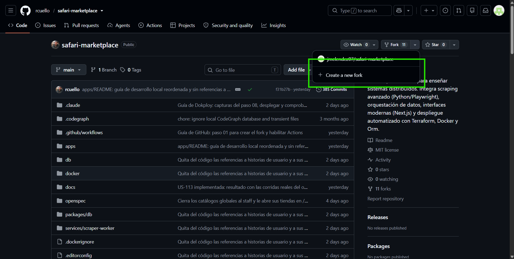
>
> *Qué debe verse:* la página de `rcuello/safari-marketplace` con el botón **Fork** arriba a la derecha.

2. Completa el formulario **Create a new fork**:

   | Campo | Valor |
   |---|---|
   | Owner | tu usuario |
   | Repository name | `safari-marketplace` (déjalo así) |
   | Copy the `main` branch only | activado |

   Pulsa **Create fork**.

> **📷 EVIDENCIA 02 — Formulario «Create a new fork»**
>
> 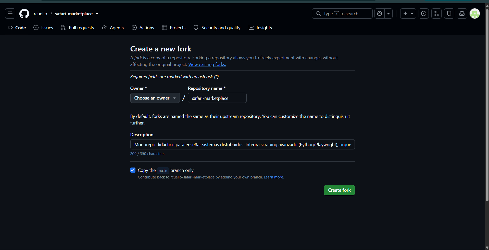
>
> *Qué debe verse:* Owner con tu usuario, nombre `safari-marketplace` y «Copy the main branch only» marcado.

3. GitHub te lleva a tu fork. Debajo del nombre dice
   **forked from rcuello/safari-marketplace**.

> **📷 EVIDENCIA 03 — El fork recién creado, con «forked from»**
>
> 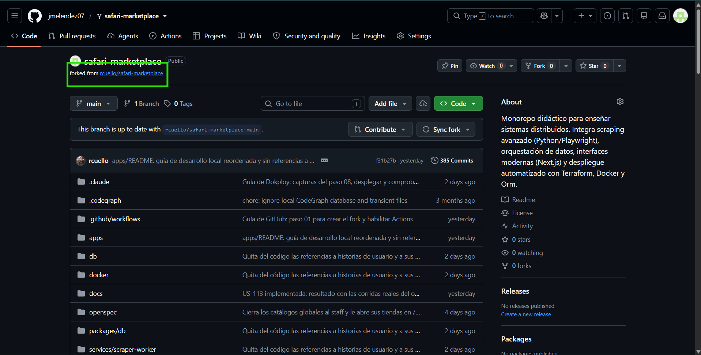
>
> *Qué debe verse:* el nombre de tu repositorio, la marca «forked from rcuello/safari-marketplace» y la rama `main`.

> El fork debe quedar **público**. No lo cambies a privado: Dokploy lo clona sin
> credenciales en cada despliegue.

### 3.2 Habilitar GitHub Actions

GitHub deja los workflows **desactivados** en un fork recién creado, para que no
se ejecute código ajeno sin revisarlo. Hasta que los habilites, el CI no corre.

4. En tu fork, entra a la pestaña **Actions**. Verás el aviso
   «Workflows aren't being run on this forked repository». Pulsa
   **I understand my workflows, go ahead and enable them**.

> **📷 EVIDENCIA 04 — Aviso para habilitar los workflows**
>
> 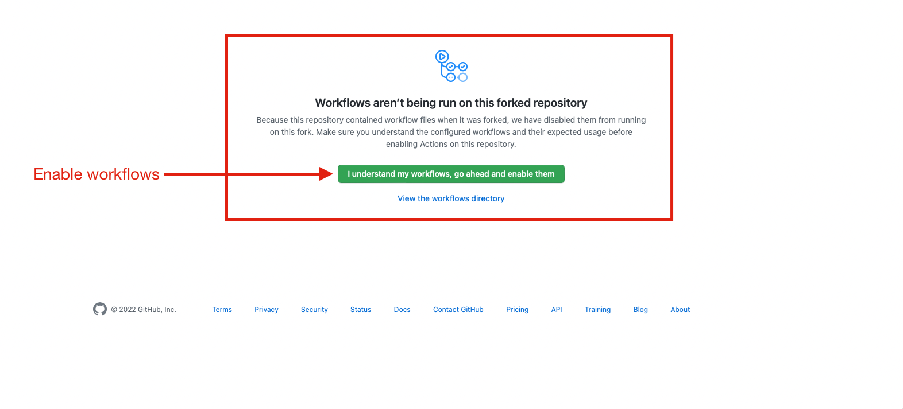
>
> *Qué debe verse:* la pestaña **Actions** del fork con el botón para habilitar los workflows.

5. La pestaña muestra el workflow **CI/CD** en la lista de la izquierda, todavía
   sin corridas.

> **📷 EVIDENCIA 05 — Workflow CI/CD habilitado**
>
> 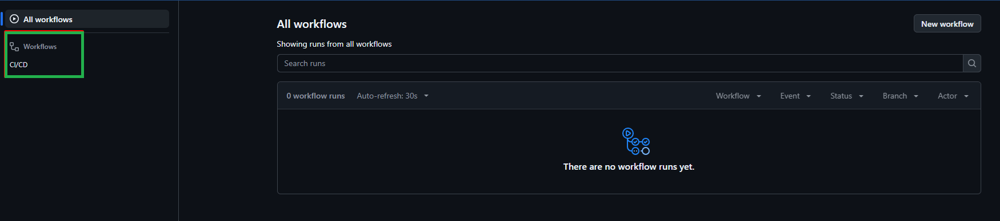
>
> *Qué debe verse:* el workflow **CI/CD** en la lista lateral de Actions.

### 3.3 Lanzar la primera corrida (todavía sin Docker Hub)

El CI corre solo con cada push a `main`. Para la primera vez no hace falta ningún
commit: se lanza a mano.

6. En **Actions**, elige **CI/CD** en la lista de la izquierda y pulsa
   **Run workflow**. Deja la rama **main** y pulsa el botón **Run workflow**.

> **📷 EVIDENCIA 06 — Menú «Run workflow» sobre la rama main**
>
> 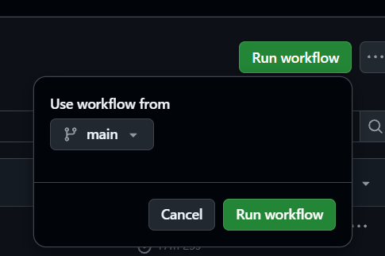
>
> *Qué debe verse:* el desplegable con la rama `main` seleccionada y el botón verde **Run workflow**.

> **📷 EVIDENCIA 06b — Corrida en curso**
>
> 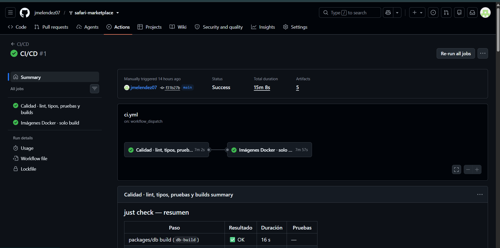
>
> *Qué debe verse:* la corrida recién creada en estado **In progress**.

7. La corrida tarda unos **10 a 15 minutos**: primero el job de calidad (lint,
   tipos, pruebas y builds) y después el de imágenes.

   Como **todavía no configuraste Docker Hub**, el job de imágenes se llama
   **«Imágenes Docker · solo build»**: construye las cinco imágenes, no las
   publica y termina en verde. Al final de la página, el resumen dice:

   ```text
   Construidas sin publicar: este fork no tiene la variable DOCKERHUB_USERNAME.
   ```

> **📷 EVIDENCIA 07 — Resumen de la primera corrida «solo build»**
>
> 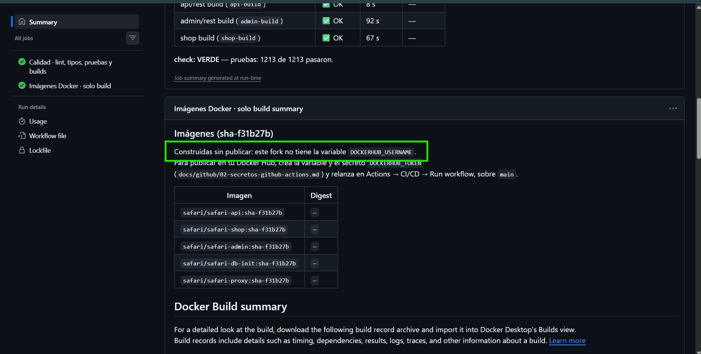
>
> *Qué debe verse:* la corrida en verde y el aviso de que las imágenes se construyeron sin publicar.

Es lo esperado. En el paso siguiente configuras Docker Hub y relanzas para que
publique.

### 3.4 Crear el token de Docker Hub

El CI no usa tu contraseña de Docker Hub, sino un **Personal Access Token**
(PAT). Así puedes revocarlo sin cambiar la contraseña y su permiso es limitado.

1. Entra a https://hub.docker.com e inicia sesión.
2. Haz clic en tu avatar (arriba a la derecha) y elige **Account settings**.

> **📷 EVIDENCIA 08 — Menú del avatar con «Account settings»**
>
> 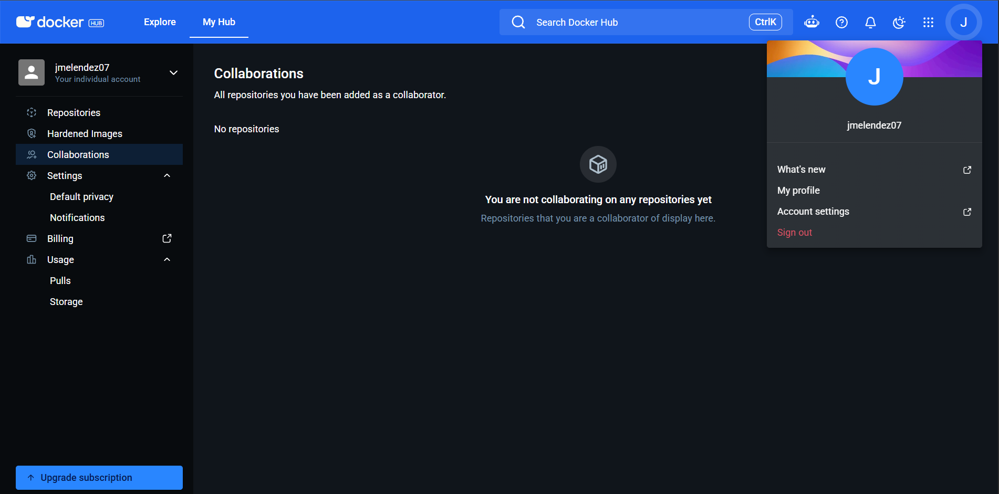
>
> *Qué debe verse:* el menú desplegable del avatar con la opción **Account settings**.

3. En el menú lateral, entra a **Personal access tokens** y pulsa
   **Generate new token**.

> **📷 EVIDENCIA 09 — Página «Personal access tokens»**
>
> 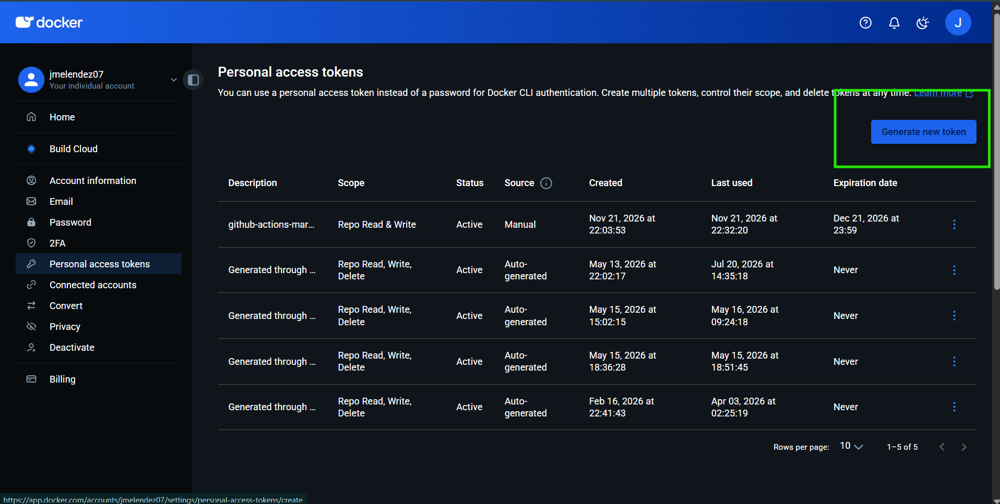
>
> *Qué debe verse:* la lista de tokens y el botón **Generate new token**.

4. Completa el formulario:
   - **Access token description:** algo que te diga para qué es, por ejemplo
     `github-actions-marketplace`.
   - **Expiration date:** 30 days.
   - **Access permissions:** **Repo Read & Write**. Hace falta escritura para
     publicar imágenes.

> **📷 EVIDENCIA 10 — Formulario del token con «Repo Read & Write»**
>
> 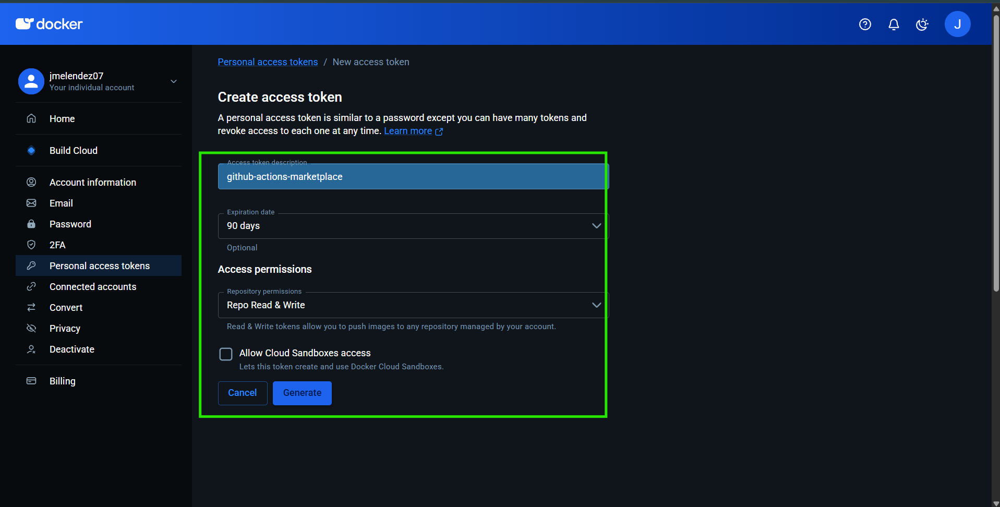
>
> *Qué debe verse:* la descripción, la fecha de expiración y el permiso **Repo Read & Write** seleccionado.

5. Pulsa **Generate** y **copia el token**. Docker Hub solo lo muestra una vez: si
   cierras la ventana sin copiarlo, tendrás que generar otro.

> **📷 EVIDENCIA 11 — Token generado, con el botón de copiar**
>
> 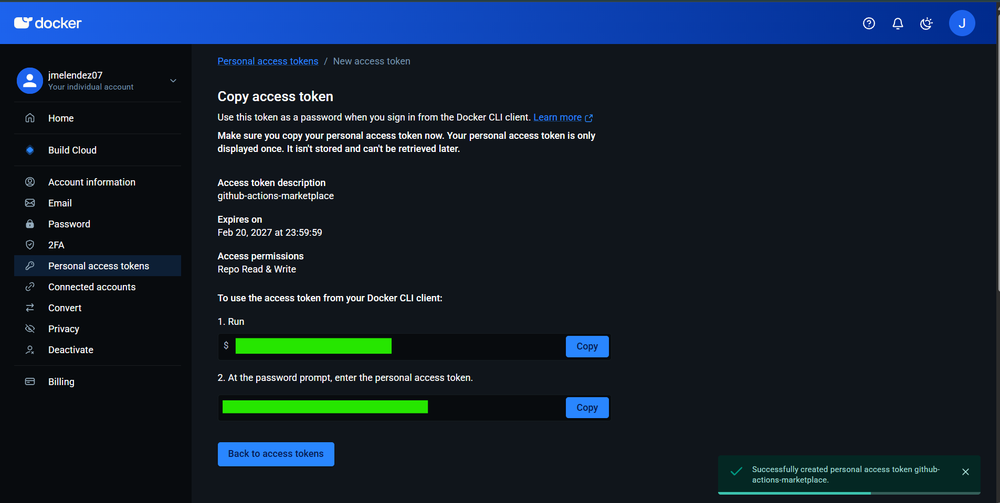
>
> *Qué debe verse:* el token recién creado y el botón de copiar. **No publiques esta captura sin tapar el token.**

Guárdalo un momento en un lugar seguro mientras haces los pasos siguientes.

### 3.5 Guardar el secreto y la variable en GitHub

GitHub Actions guarda dos tipos de valores:

- **Secreto:** un valor sensible, como un token. Una vez guardado **no se puede
  volver a ver**; solo reemplazar. En el workflow se lee como
  `${{ secrets.NOMBRE }}`.
- **Variable:** un valor no secreto, como un usuario. Se puede ver y editar. En
  el workflow se lee como `${{ vars.NOMBRE }}`.

Regla práctica: si alguien que lo ve podría usarlo para entrar a tu cuenta, es un
**secreto**.

#### Opción A: desde la interfaz web

1. Entra a tu repositorio en GitHub
   (`https://github.com/<tu-usuario>/safari-marketplace`).
2. Pulsa la pestaña **Settings** (la última de la barra superior). Si no la ves,
   no tienes permisos de administrador en ese repositorio.

> **📷 EVIDENCIA 12 — Barra del repositorio con «Settings»**
>
> 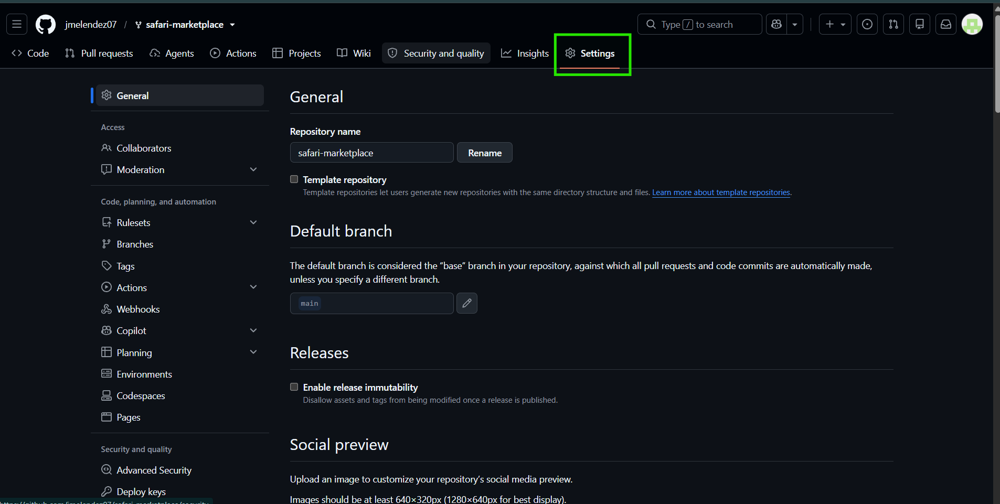
>
> *Qué debe verse:* la barra superior del repositorio con la pestaña **Settings**.

3. En el menú lateral, abre **Secrets and variables** y elige **Actions**.

> **📷 EVIDENCIA 13 — Menú «Secrets and variables → Actions»**
>
> 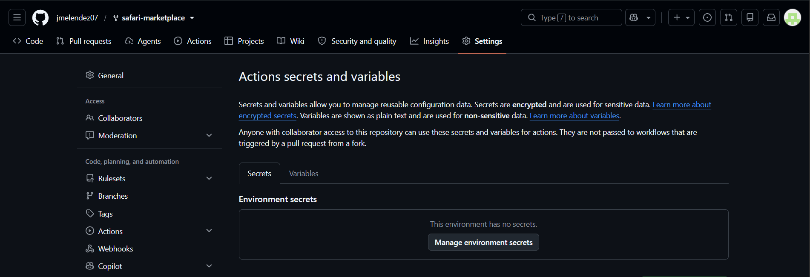
>
> *Qué debe verse:* el menú lateral de Settings con esa opción resaltada.

Atajo: también puedes ir directo a
`https://github.com/<tu-usuario>/safari-marketplace/settings/secrets/actions`.

**Crear el secreto `DOCKERHUB_TOKEN`:**

4. En la pestaña **Secrets**, pulsa **New repository secret**.

> **📷 EVIDENCIA 14 — Botón «New repository secret»**
>
> 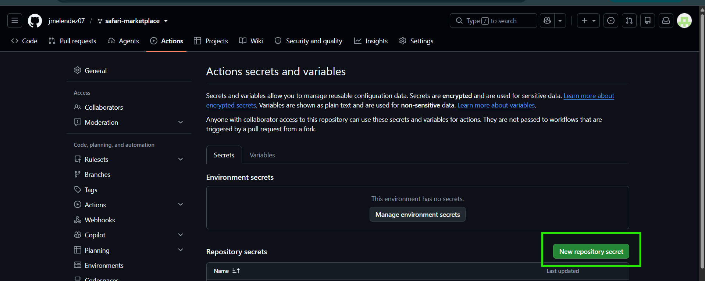
>
> *Qué debe verse:* la pestaña **Secrets** con el botón **New repository secret**.

5. Completa:
   - **Name:** `DOCKERHUB_TOKEN` (exactamente así, en mayúsculas).
   - **Secret:** pega el token de Docker Hub.

> **📷 EVIDENCIA 15 — Formulario del secreto `DOCKERHUB_TOKEN`**
>
> 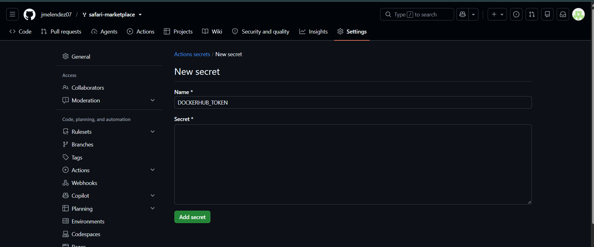
>
> *Qué debe verse:* el nombre exacto y el campo del valor. **Tapa el token antes de compartir la imagen.**

6. Pulsa **Add secret**. El secreto aparece en la lista con la fecha de
   actualización; su valor ya no se puede ver.

> **📷 EVIDENCIA 16 — Secreto creado**
>
> 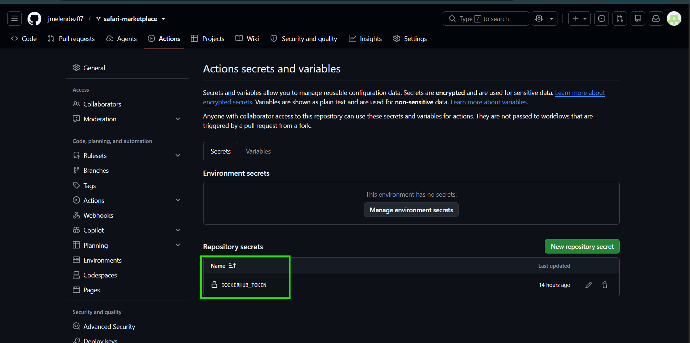
>
> *Qué debe verse:* `DOCKERHUB_TOKEN` en la lista de secretos, sin valor visible.

**Crear la variable `DOCKERHUB_USERNAME`:**

7. En la misma página, cambia a la pestaña **Variables** y pulsa
   **New repository variable**.

> **📷 EVIDENCIA 17 — Pestaña «Variables»**
>
> 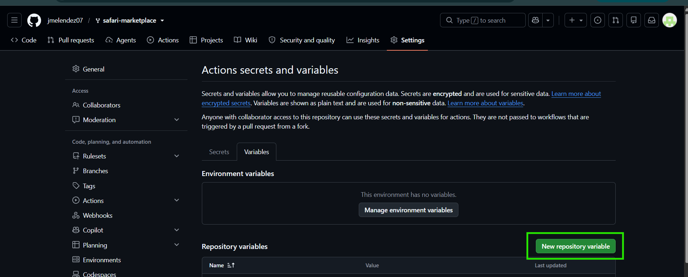
>
> *Qué debe verse:* la pestaña **Variables** con el botón **New repository variable**.

8. Completa:
   - **Name:** `DOCKERHUB_USERNAME`
   - **Value:** tu usuario de Docker Hub, tal como aparece en tu perfil (sin `@`
     ni la URL).

> **📷 EVIDENCIA 18 — Formulario de la variable `DOCKERHUB_USERNAME`**
>
> 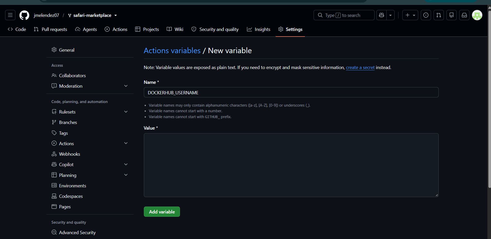
>
> *Qué debe verse:* el nombre exacto y tu usuario de Docker Hub como valor.

9. Pulsa **Add variable**.

> **📷 EVIDENCIA 19 — Variable creada**
>
> 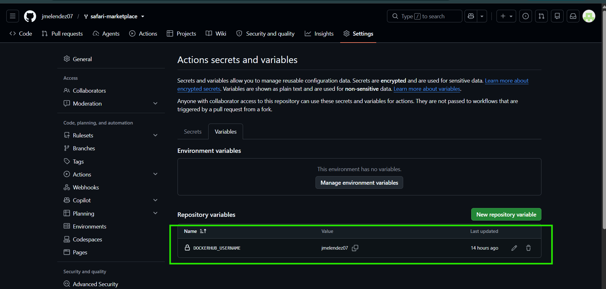
>
> *Qué debe verse:* `DOCKERHUB_USERNAME` en la lista de variables con su valor.

#### Opción B: desde la terminal con GitHub CLI

Si prefieres la terminal, instala `gh` y autentícate.

**Windows** (PowerShell o Terminal):

```powershell
winget install --id GitHub.cli
```

Cierra y vuelve a abrir la terminal. **macOS**:

```bash
brew install gh
```

**Linux (Debian/Ubuntu):** sigue https://github.com/cli/cli/blob/trunk/docs/install_linux.md.

Comprueba e inicia sesión:

```bash
gh --version
gh auth login
```

Responde:

1. **Where do you use GitHub?** → `GitHub.com`
2. **Preferred protocol for Git operations?** → `HTTPS`
3. **Authenticate Git with your GitHub credentials?** → `Yes`
4. **How would you like to authenticate?** → `Login with a web browser`

`gh` muestra un código de 8 caracteres y abre el navegador. Pégalo y autoriza.

Crea el secreto (te pide el valor sin mostrarlo) y la variable:

```bash
gh secret set DOCKERHUB_TOKEN --repo <tu-usuario>/safari-marketplace
gh variable set DOCKERHUB_USERNAME --body <tu-usuario-de-docker-hub> --repo <tu-usuario>/safari-marketplace
```

> No pases el token como argumento (`--body <token>`): quedaría en el historial de
> tu terminal.

Comprueba:

```bash
gh secret list --repo <tu-usuario>/safari-marketplace
gh variable list --repo <tu-usuario>/safari-marketplace
```

Salida esperada (las fechas cambian):

```text
NAME             UPDATED
DOCKERHUB_TOKEN  less than a minute ago

NAME                VALUE       UPDATED
DOCKERHUB_USERNAME  mi-usuario  less than a minute ago
```

### 3.6 Relanzar el CI para que publique

La prueba definitiva es una nueva ejecución del workflow después de configurar
Docker Hub. No hace falta otro commit.

1. En **Actions → CI/CD → Run workflow**, elige la rama `main` y pulsa
   **Run workflow**. Con la terminal:

   ```bash
   gh workflow run ci.yml --ref main --repo <tu-usuario>/safari-marketplace
   ```

2. Espera a que termine. Ahora el job se llama
   **«Imágenes Docker · build y publicación»** y el paso de login en Docker Hub
   debe estar en verde.

> **📷 EVIDENCIA 20 — Corrida con publicación en verde**
>
> 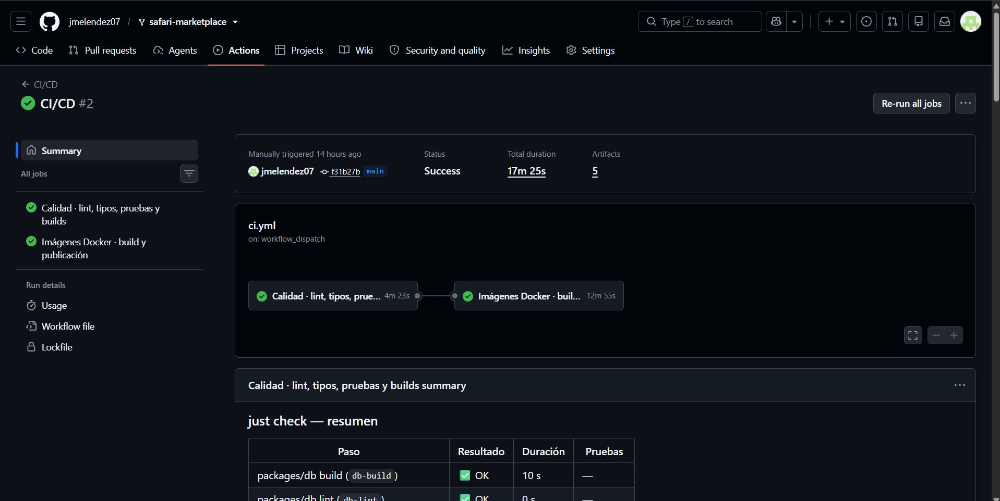
>
> *Qué debe verse:* el job **«Imágenes Docker · build y publicación»** terminado en verde.

3. Al final de la página, el resumen **«Imágenes (sha-xxxxxxx)»** lista las cinco
   imágenes publicadas en tu cuenta.

> **📷 EVIDENCIA 21 — Resumen «Imágenes (sha-…)»**
>
> 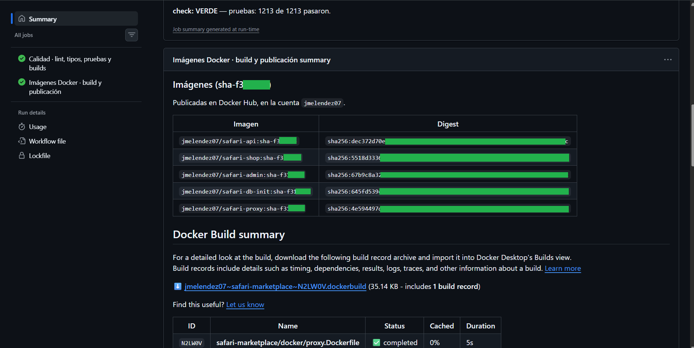
>
> *Qué debe verse:* las cinco imágenes con la misma etiqueta `sha-` y el texto de publicación en tu cuenta.

4. Verifica en Docker Hub: entra a
   `https://hub.docker.com/repositories/<tu-usuario-de-docker-hub>` y deben
   aparecer los cinco repositorios.

### 3.7 Elegir y anotar el `IMAGE_TAG`

1. En tu fork, entra a **Actions** y abre la última corrida verde de `main`.
2. Al final de la página está el resumen **«Imágenes (sha-xxxxxxx)»**, con las
   cinco imágenes publicadas.
3. Anota esa etiqueta completa, con el `sha-` incluido.

```text
IMAGE_TAG = sha-4fcb7f1
```

Las cinco imágenes de un mismo commit llevan la misma etiqueta. Se despliegan
siempre juntas. La API devuelve el commit completo en `/backend/health`, así que
después podrás comprobar qué versión corre.

### 3.8 Mantener el fork al día

Cuando el repositorio original tenga cambios, tu fork muestra
**This branch is N commits behind**. Para traerlos, pulsa **Sync fork →
Update branch**.

> **Cada sincronización cuenta como un push a `main`:** lanza el CI y, si ya
> configuraste Docker Hub, publica imágenes nuevas con otra etiqueta. Tu
> despliegue **no cambia** hasta que actualices `IMAGE_TAG` en Dokploy.

### 3.9 Problemas frecuentes de esta fase

| Síntoma | Causa probable | Qué hacer |
|---|---|---|
| No veo la pestaña **Settings** | No eres administrador del repositorio | Pide el rol *Admin* o que el dueño cree el secreto |
| El CI dice que falta `DOCKERHUB_TOKEN` o `DOCKERHUB_USERNAME` | El nombre está mal escrito o lo creaste en otro repositorio | Revisa mayúsculas y guiones bajos, y el repositorio en `gh secret list` |
| `unauthorized: incorrect username or password` en el login | Token mal pegado, vencido o revocado | Genera un token nuevo y reemplaza el secreto con el mismo nombre |
| `denied: requested access to the resource is denied` al publicar | El token es de solo lectura o el usuario no coincide con el de la imagen | Crea el token con **Repo Read & Write** y revisa `DOCKERHUB_USERNAME` |
| El resumen dice «Construidas sin publicar: este fork no tiene la variable `DOCKERHUB_USERNAME`» | El fork no hereda secretos ni variables del repositorio original | Crea la variable y el secreto en **tu** fork y relanza con **Run workflow** sobre `main` |
| `gh: command not found` | `gh` no está instalado o la terminal no se reinició | Repite la instalación y abre una terminal nueva |
| El job de calidad falla | Un problema real del código o del entorno del runner | Abre el step rojo; no sigas a la fase 5 hasta tener una corrida verde |

**Cambiar o borrar un secreto:**

- Reemplazar: en la web, el lápiz junto al secreto; en la terminal, vuelve a
  ejecutar `gh secret set DOCKERHUB_TOKEN`.
- Borrar: el ícono de papelera, o
  `gh secret delete DOCKERHUB_TOKEN --repo <tu-usuario>/safari-marketplace`.
- Si el token se filtró: **primero revócalo** en Docker Hub (*Account settings →
  Personal access tokens → Delete*), después crea otro y reemplaza el secreto.

---

## 4. Fase 2. Cloudflare: cuenta y dominio

**Objetivo:** tener una cuenta de Cloudflare protegida con 2FA y un dominio
propio, con su DNS administrado por Cloudflare.

**Al terminar:** el dominio aparece en tu cuenta y puedes crear registros.

Cloudflare cumple dos papeles: es el **registrador** (te vende el dominio) y el
**DNS** (dice a qué IP apunta cada subdominio). El HTTPS **no** lo pone Cloudflare:
lo emite Let's Encrypt desde Dokploy.

> **Antes de la fase 4** necesitas la IP de tu VM. Puedes hacer la fase 2 antes de
> crear el servidor.

### 4.1 Crear la cuenta

1. Entra a https://dash.cloudflare.com/sign-up.
2. Escribe tu **Email** y una **Password**. Usa un correo al que tengas acceso: lo
   necesitarás para verificar la cuenta y el dominio.
3. Pulsa **Create Account** (o **Sign up**).

4. Si Cloudflare pregunta para qué vas a usar la cuenta o qué plan quieres, elige
   el plan **Free**. Todo lo de esta guía es gratis, salvo el dominio.

5. Abre el correo de Cloudflare (revisa spam si no aparece), pulsa el enlace de
   verificación y vuelve al panel. El aviso de «verifica tu email» desaparece.

> Sin el email verificado no puedes activar 2FA, y la compra del dominio también
> lo pide.

### 4.2 Activar la autenticación en dos pasos (2FA)

La cuenta controla el dominio: si alguien entra, puede apuntarlo a otro servidor.
Protégela con 2FA.

1. En el panel, abre el menú de tu perfil (arriba a la derecha) y elige
   **My Profile**.
2. Entra a **Authentication**.

3. Junto a **Mobile App Authentication**, pulsa **Add** y escanea el código QR con
   una app de autenticación (Google Authenticator, Microsoft Authenticator, Authy
   o similar).
4. Escribe el código de 6 dígitos para confirmarlo.
5. **Guarda los códigos de recuperación** (*backup codes*) en un lugar seguro. Si
   pierdes el teléfono, son la única forma de volver a entrar.

> **📷 EVIDENCIA 22 — 2FA activo en Cloudflare**
>
> 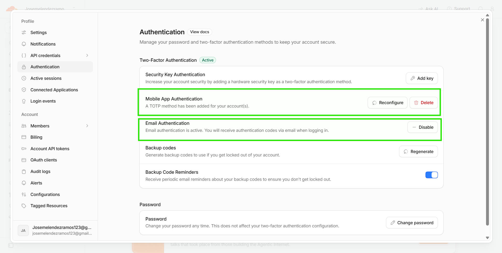
>
> *Qué debe verse:* la confirmación de que la autenticación en dos pasos quedó activa. **No muestres el secreto ni los códigos de recuperación.**

### 4.3 Comprar el dominio

Cloudflare Registrar vende los dominios **a precio de costo**: lo que cobran el
registro del TLD (`.com`, `.dev`…) y la ICANN, sin recargo.

Antes de comprar:

- Necesitas un método de pago (tarjeta o el medio que acepte Cloudflare en tu
  país). El dominio es lo único que se paga en todo el despliegue, aparte del VPS.
- El registro pide nombre, dirección y email del titular (*registrant*).
  Cloudflare los oculta en el WHOIS público.
- Si el curso es en grupo, acuerden quién compra el dominio y en qué cuenta queda.

1. En el panel, en el menú lateral, entra a
   **Domain Registration → Register Domains** (o **Registrar → Register**).

2. Escribe el nombre que quieres y pulsa **Search**. También puedes escribir
   palabras clave para ver sugerencias. Si el nombre buscado no aparece, no está
   disponible.

3. Pulsa **Purchase** en el dominio elegido. Cloudflare comprueba otra vez que
   esté disponible.

4. En **Payment option**, elige por cuántos años lo registras. Para el curso basta
   con **1 año**. La fecha de vencimiento y el precio se actualizan solos.

5. Completa los datos de contacto del titular y el método de pago.

6. Revisa el resumen y confirma la compra.

### 4.4 Después de comprar

- **Renovación automática:** viene **activada**. Al año, Cloudflare cobra la
  renovación al precio de lista. Si el dominio es solo para el curso y no quieres
  renovarlo, desactívala en la página del dominio (**Manage domain → Auto-renew**).

- **Verificación del email de contacto:** si el email del titular no es el de tu
  cuenta, te llega otro correo. **Hay que verificarlo en 15 días.** Si no, el
  dominio queda retenido y deja de resolver.
- **El dominio aparece en tu cuenta** en **Websites** (o **Domains**), ya con el
  DNS de Cloudflare activo. No hay que cambiar *nameservers*.

> **📷 EVIDENCIA 23 — El dominio en tu cuenta de Cloudflare**
>
> 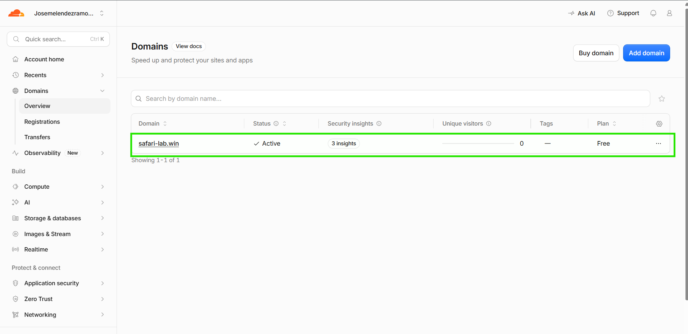
>
> *Qué debe verse:* tu dominio listado en Cloudflare con estado activo.

### 4.5 Si ya tienes un dominio en otro proveedor

No hace falta comprar otro. Tienes dos opciones:

- **Crear los registros en tu proveedor actual**, con los valores de la fase 4. El
  resto de la guía no cambia.
- **Agregar el dominio a Cloudflare** (*Add a domain* en el panel) y cambiar los
  *nameservers* en tu proveedor por los que indique Cloudflare. Sigue la
  [documentación oficial](https://developers.cloudflare.com/dns/zone-setups/full-setup/setup/).

---

## 5. Fase 3. Azure for Students y la máquina virtual

**Objetivo:** tener un VPS Linux con IP estática, los puertos de Dokploy abiertos
y acceso por SSH con tu llave `.pem`.

**Al terminar:** `ssh` funciona y anotaste la IP pública.

```text
tu equipo ──ssh──▶ VM Ubuntu en Azure (IP pública fija)
                     ├─ 80 / 443  → Traefik (tienda y admin, con Let's Encrypt)
                     └─ 3000      → panel de Dokploy (hasta ponerle dominio)
```

### 5.1 Activar Azure for Students

**Azure for Students** da **USD 100 de crédito por 12 meses**, sin tarjeta de
crédito. Solo pide verificar que eres estudiante con el email de tu universidad.

1. Entra a https://azure.microsoft.com/free/students y pulsa **Start free** (o
   **Activar ahora**).

2. Inicia sesión con una cuenta Microsoft. Puede ser la de tu universidad o una
   personal.
3. Verifica tu condición de estudiante con el **email de la universidad**:
   Microsoft te manda un código a ese correo.

4. Acepta los términos. Al terminar, el portal https://portal.azure.com se abre
   con la suscripción activa.
5. Comprueba la suscripción: en el buscador del portal escribe **Subscriptions**.
   Tiene que aparecer **Azure for Students** con estado **Active**.

> **El crédito restante** se ve en https://www.microsoftazuresponsorships.com.
> Si se acaba o pasan los 12 meses, la suscripción se deshabilita y la VM se
> detiene. Revisa el saldo de vez en cuando.

### 5.2 Crear la máquina virtual

En el portal, busca **Virtual machines** y pulsa **Create → Azure virtual machine**.

#### Pestaña Basics

1. **Project details** e **Instance details**:

   | Campo | Valor | Por qué |
   |---|---|---|
   | Subscription | **Azure for Students** | Usa el crédito de estudiante |
   | Resource group | **Create new** → `rg-safari` | Agrupa todo: al terminar se borra de una vez |
   | Virtual machine name | `vm-dokploy` | |
   | Region | la más cercana con disponibilidad, por ejemplo **East US** | Si el tamaño no está disponible, prueba otra región |
   | Availability options | **No infrastructure redundancy required** | Una sola VM |
   | Security type | **Standard** | |
   | Image | **Ubuntu Server 24.04 LTS - x64 Gen2** | Linux **x64**: las imágenes son `linux/amd64` |
   | VM architecture | **x64** | |
   | Size | **Standard B2s** (2 vCPU, 4 GiB) | Dokploy pide 2 GB; con 4 vas holgado. La B1s (1 GiB) no alcanza |

   Si **Standard B2s** no aparece, pulsa **See all sizes** y búscala.

2. **Administrator account**:

   | Campo | Valor |
   |---|---|
   | Authentication type | **SSH public key** |
   | Username | `azureuser` |
   | SSH public key source | **Generate new key pair** |
   | SSH Key Type | **RSA SSH Format** |
   | Key pair name | `vm-dokploy-key` |

   Con una llave SSH, la VM no acepta contraseñas: nadie puede entrar
   adivinándola.

3. **Inbound port rules**:

   | Campo | Valor |
   |---|---|
   | Public inbound ports | **Allow selected ports** |
   | Select inbound ports | **SSH (22)**, **HTTP (80)** y **HTTPS (443)** |

   El portal avisa que los puertos quedan abiertos a internet: es lo que necesita
   Dokploy. El `3000` se abre después.

#### Pestaña Disks

4. Pulsa **Next: Disks**:

   | Campo | Valor | Por qué |
   |---|---|---|
   | OS disk size | **64 GiB** | Dokploy pide 30 GB como mínimo y las imágenes ocupan varios GB |
   | OS disk type | **Standard SSD** | Más barato que Premium y suficiente |
   | Delete with VM | activado | Borra el disco si borras la VM |

#### Pestaña Networking

5. Pulsa **Next: Networking**. Deja lo que propone Azure (red virtual nueva,
   subred y **IP pública** nueva) y activa
   **Delete public IP and NIC when VM is deleted**.

   La IP pública es de tipo **Standard** y **estática**: no cambia aunque detengas
   y vuelvas a arrancar la VM, así que el DNS sigue sirviendo.

#### Crear

6. Pulsa **Review + create**. Azure valida y muestra el **costo estimado por
   hora**. Revisa que diga **Validation passed** y pulsa **Create**.

7. Se abre **Generate new key pair**. Pulsa
   **Download private key and create resource**: el navegador descarga
   `vm-dokploy-key.pem`.

> **Guarda bien ese archivo.** Es la única forma de entrar a la VM y Azure no lo
> vuelve a mostrar. No lo subas a ningún repositorio ni lo compartas.

8. El despliegue tarda uno o dos minutos. Cuando diga
   **Your deployment is complete**, pulsa **Go to resource**.

9. En **Overview** de la VM, anota la **Public IP address**. La usarás para el DNS
   y para entrar por SSH.

> **📷 EVIDENCIA 24 — VM creada, con su IP pública**
>
> 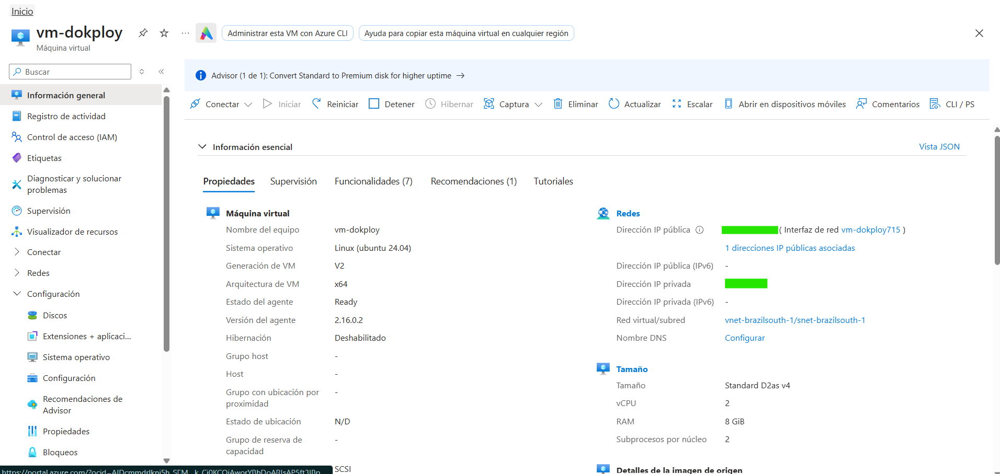
>
> *Qué debe verse:* el estado de la VM y la IP pública. **Tápala antes de compartir la imagen.**

### 5.3 Abrir los puertos de Dokploy

La IP pública de una VM nueva (SKU Standard) llega **cerrada a todo el tráfico
entrante**, salvo lo que permitas. Ya abriste 22, 80 y 443. Falta el **3000**, el
del panel de Dokploy:

| Puerto | Para qué |
|---|---|
| `22` | SSH: tu conexión a la VM |
| `80` | HTTP: Traefik y la validación de Let's Encrypt |
| `443` | HTTPS: la tienda y el admin |
| `3000` | El panel de Dokploy, solo mientras le pones dominio |

1. En la VM, entra a **Networking → Network settings**. Verás las reglas de
   entrada que creó la fase anterior.

2. Pulsa **Create port rule → Inbound port rule** y completa:

   | Campo | Valor |
   |---|---|
   | Source | **Any** |
   | Source port ranges | `*` |
   | Destination | **Any** |
   | Service | **Custom** |
   | Destination port ranges | `3000` |
   | Protocol | **TCP** |
   | Action | **Allow** |
   | Priority | la que propone Azure |
   | Name | `Allow-Dokploy-3000` |

   Pulsa **Add**.

3. La lista muestra las cuatro reglas: **22, 80, 443 y 3000**.

> **📷 EVIDENCIA 25 — Reglas de entrada 22, 80, 443 y 3000**
>
> 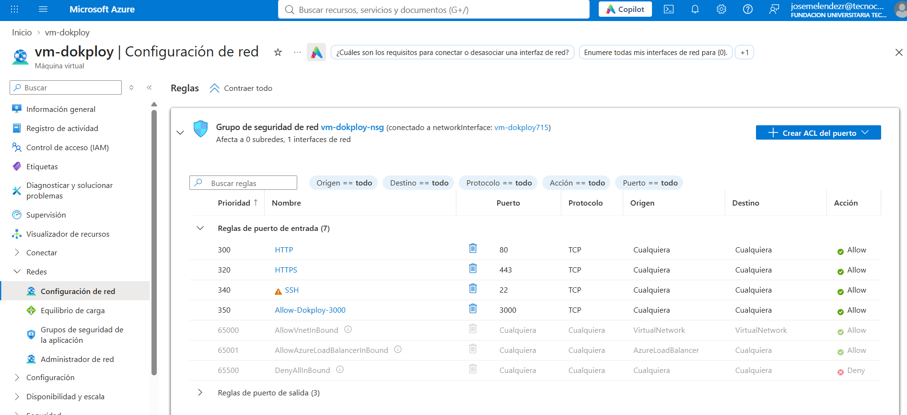
>
> *Qué debe verse:* las cuatro reglas de entrada abiertas.

> **Cierra el 3000 después.** Cuando el panel responda en
> `https://dokploy.<tu-dominio>`, borra la regla `Allow-Dokploy-3000`: el panel ya
> entra por el 443.

### 5.4 Conectarse por SSH

Entras con el usuario **`azureuser`** y la llave `vm-dokploy-key.pem`. Azure no
permite entrar como `root`: los comandos de administración van con `sudo`.

#### Preparar la llave

Mueve la llave a la carpeta `.ssh` y deja que solo tú puedas leerla. Sin esto,
SSH la rechaza con `WARNING: UNPROTECTED PRIVATE KEY FILE!`.

**Windows (PowerShell):**

```powershell
mkdir $HOME\.ssh -Force
Move-Item $HOME\Downloads\vm-dokploy-key.pem $HOME\.ssh\
icacls $HOME\.ssh\vm-dokploy-key.pem /inheritance:r /grant:r "$($env:USERNAME):R"
```

**macOS, Linux o Git Bash:**

```bash
mkdir -p ~/.ssh
mv ~/Downloads/vm-dokploy-key.pem ~/.ssh/
chmod 400 ~/.ssh/vm-dokploy-key.pem
```

#### Entrar a la VM

1. Conéctate con la IP pública:

   ```bash
   ssh -i ~/.ssh/vm-dokploy-key.pem azureuser@<IP-de-la-VM>
   ```

   La primera vez pregunta si confías en el servidor
   (`Are you sure you want to continue connecting`). Escribe `yes`.

2. Al entrar, el prompt cambia a `azureuser@vm-dokploy:~$`.

3. Comprueba que la VM es la esperada:

   ```bash
   uname -m        # x86_64
   free -h         # ~3.8Gi de memoria total
   df -h /         # ~62G de disco
   ```

> **📷 EVIDENCIA 26 — SSH conectado y comprobaciones de la VM**
>
> 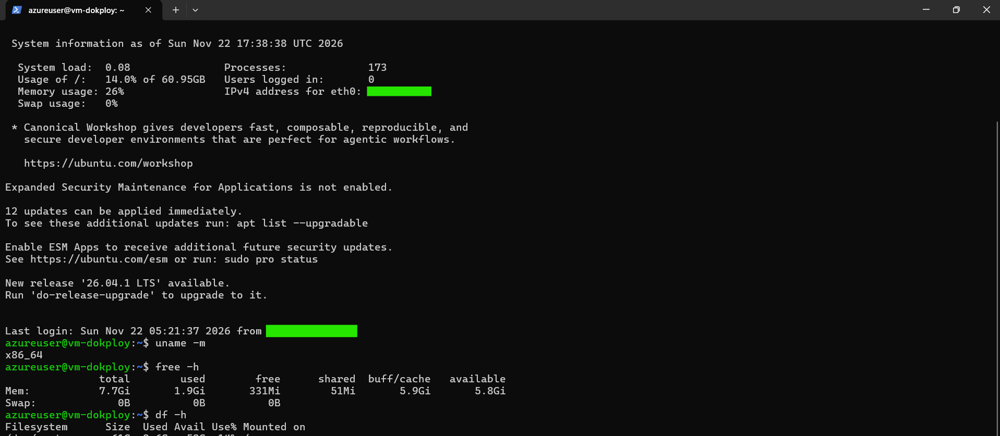
>
> *Qué debe verse:* el prompt `azureuser@vm-dokploy` y la salida de `uname -m`, `free -h` y `df -h`. **Tapa la IP.**

#### Atajo opcional

Para no escribir la llave y la IP cada vez, agrega esto a `~/.ssh/config` (en
Windows, `C:\Users\<tu-usuario>\.ssh\config`):

```text
Host dokploy
  HostName <IP-de-la-VM>
  User azureuser
  IdentityFile ~/.ssh/vm-dokploy-key.pem
```

Desde ahí basta con `ssh dokploy`.

#### Problemas frecuentes de SSH

| Síntoma | Causa | Solución |
|---|---|---|
| `WARNING: UNPROTECTED PRIVATE KEY FILE!` | La llave tiene permisos abiertos | Repite «Preparar la llave» |
| `Permission denied (publickey)` | Usuario o llave equivocados | El usuario es `azureuser`, no `root`, y la llave es la de esta VM |
| `Connection timed out` | El puerto 22 no está abierto o la IP es otra | Revisa las reglas y la IP en **Overview** |
| Perdiste el `.pem` | Azure no lo guarda | En la VM: **Help → Reset password → Reset SSH public key**, con una llave nueva |

### 5.5 Si usas otro proveedor de VPS

No necesitas Azure. Cualquier VPS que cumpla esto sirve:

- arquitectura **x86_64/amd64**;
- **2 GB** de RAM mínimo (4 GB recomendado);
- **30 GB** de disco mínimo;
- Ubuntu o Debian reciente;
- puertos **80, 443 y 3000** libres y accesibles.

Anota su IP pública y sigue con la fase 4. Si el proveedor te da acceso `root` por
SSH, la instalación de Dokploy se hace como `root`; no cambies nada más.

> **No publiques** tu *Subscription ID*, la IP de tu VM ni tu llave `.pem` en
> capturas, repositorios o chats.

---

## 6. Fase 4. DNS: apuntar el dominio a la VM

**Objetivo:** que `tienda`, `admin` y `dokploy` resuelvan a la IP de tu VM.

**Al terminar:** `nslookup tienda.<tu-dominio>` devuelve la IP de tu servidor.

### 6.1 Crear los tres registros A

Necesitas la **IP pública de tu VM** (fase 3). Los ejemplos usan `203.0.113.10`:
reemplázala por la tuya.

| Type | Name | IPv4 address | Proxy status | TTL |
|---|---|---|---|---|
| `A` | `tienda` | IP de la VM | **DNS only** (nube gris) | Auto |
| `A` | `admin` | IP de la VM | **DNS only** (nube gris) | Auto |
| `A` | `dokploy` | IP de la VM | **DNS only** (nube gris) | Auto |

En **Name** va solo el subdominio: `tienda`, no `tienda.tu-dominio.com`.
Cloudflare agrega el dominio.

**¿Por qué DNS only?** Así el navegador llega directo a tu VM y Let's Encrypt,
desde Dokploy, emite los certificados sin intermediarios. Activar el proxy (nube
naranja) es opcional y conviene hacerlo **después** de que todo funcione.

1. En el panel, entra a tu dominio (**Websites** → tu dominio) y abre
   **DNS → Records**.

2. Pulsa **Add record**.
3. Completa:
   - **Type:** `A`
   - **Name:** `tienda`
   - **IPv4 address:** la IP de la VM
   - **Proxy status:** apágalo, para que quede la nube gris y diga **DNS only**
   - **TTL:** `Auto`

4. Pulsa **Save**.
5. Repite los pasos 2 a 4 para `admin` y `dokploy`.

> **📷 EVIDENCIA 27 — Los tres registros A en Cloudflare**
>
> 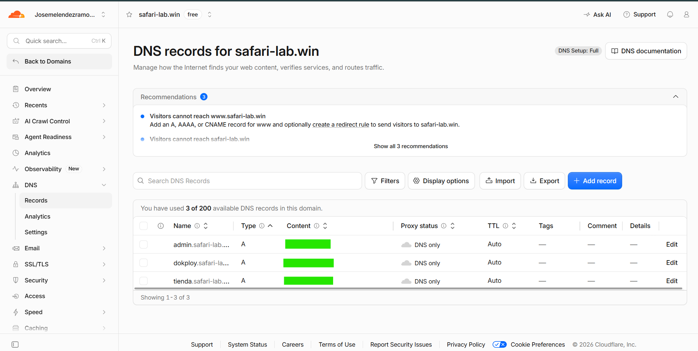
>
> *Qué debe verse:* `tienda`, `admin` y `dokploy` con la misma IP y la nube gris (DNS only). **Tapa la IP.**

#### Alternativa: un solo registro comodín

En vez de los tres, puedes crear un registro con `*` en **Name**. Así, cualquier
subdominio (`tienda`, `admin`, `dokploy` o uno nuevo) apunta a la VM:

| Type | Name | IPv4 address | Proxy status |
|---|---|---|---|
| `A` | `*` | IP de la VM | DNS only |

Es cómodo pero menos explícito: también resuelven subdominios que no usas. Para el
curso, los tres registros son más claros.

### 6.2 Comprobar que el dominio resuelve

Antes de instalar Dokploy o configurar dominios, comprueba que cada subdominio ya
apunta a tu VM.

```bash
nslookup tienda.<tu-dominio>
nslookup admin.<tu-dominio>
nslookup dokploy.<tu-dominio>
```

Cada respuesta debe terminar con la IP de tu VM.

Ejemplo real del curso (`cuadernodigital.dev` en `20.231.38.199`):

```text
C:\Users\...> nslookup tienda.cuadernodigital.dev
Server:  UnKnown
Address:  10.x.x.x

Non-authoritative answer:
Name:    tienda.cuadernodigital.dev
Address:  20.231.38.199
```

Cómo leerla:

- **`Server` / `Address` (arriba):** el DNS de **tu red**, el que hizo la consulta
  por ti. Cambia según dónde estés conectado. `UnKnown` solo significa que ese
  servidor no tiene nombre inverso; no es un error.
- **`Non-authoritative answer`:** la respuesta viene del DNS de tu red, que la
  tenía guardada. Es lo normal.
- **`Name` / `Address` (abajo):** lo que importa. El subdominio y la IP, que debe
  ser la de **tu** VM.

Comprueba también contra un DNS público. Así descartas que tu red tenga guardada
una respuesta vieja. `1.1.1.1` es el DNS de Cloudflare:

```bash
nslookup tienda.<tu-dominio> 1.1.1.1
```

Resultado de los tres subdominios del ejemplo:

```text
tienda.cuadernodigital.dev   20.231.38.199
admin.cuadernodigital.dev    20.231.38.199
dokploy.cuadernodigital.dev  20.231.38.199
```

Los tres apuntan a la misma IP: todo llega al mismo VPS, y Traefik decide a qué
aplicación va cada subdominio.

En macOS o Linux también sirve `dig +short tienda.<tu-dominio>`, que imprime solo
la IP.

> **📷 EVIDENCIA 28 — Los tres subdominios resuelven a la VM**
>
> 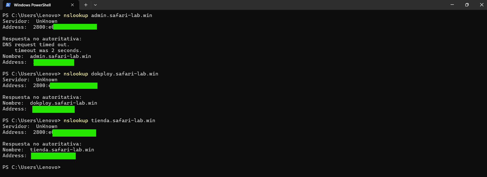
>
> *Qué debe verse:* la salida de `nslookup` para los tres subdominios, con la IP de tu VM.

### 6.3 Si todavía no resuelve

| Síntoma | Causa probable | Qué hacer |
|---|---|---|
| `Non-existent domain` o `NXDOMAIN` justo después de comprar | El dominio recién registrado aún se está activando | Espera unos minutos y vuelve a probar |
| Resuelve a otra IP | El registro tiene la IP equivocada o tu red guarda una respuesta vieja | Revisa **DNS → Records**; prueba con `nslookup tienda.<tu-dominio> 1.1.1.1` |
| Resuelve a IPs de Cloudflare, no a la de tu VM | El registro quedó en **Proxied** (nube naranja) | Cámbialo a **DNS only** |
| Dejó de resolver días después de la compra | No verificaste el email de contacto del dominio | Busca el correo de verificación de la fase 2 |
| `nslookup` funciona pero el navegador no | Caché del navegador o del sistema | Prueba en una ventana privada o cambia el DNS del equipo a `1.1.1.1` |

**Si cambias de VPS:** edita los tres registros (el lápiz de cada fila) y pon la IP
nueva. Con TTL `Auto`, el cambio llega en pocos minutos.

---

## 7. Fase 5. Desplegar con Dokploy

**Objetivo:** instalar Dokploy en la VM y levantar el stack completo desde tus
imágenes, con `tienda` y `admin` en HTTPS.

**Al terminar:** la tienda muestra productos con candado válido, el admin abre y
ya no acepta la contraseña demo.

### 7.1 Checklist antes de empezar

- [ ] Fork público en GitHub.
- [ ] Secreto `DOCKERHUB_TOKEN` y variable `DOCKERHUB_USERNAME` creados.
- [ ] Corrida verde de `main` con el job **«Imágenes Docker · build y publicación»**.
- [ ] Las cinco imágenes visibles en tu Docker Hub.
- [ ] `IMAGE_TAG` anotado (`sha-…`).
- [ ] Dominio comprado y DNS administrable.
- [ ] VM con IP estática y puertos 22, 80, 443 y 3000 abiertos.
- [ ] `nslookup` de los tres subdominios devuelve la IP de la VM.
- [ ] Acceso SSH a la VM comprobado.

Si hiciste las fases 1 a 4, ya los cumples.

### 7.2 Instalar Dokploy

> **Video de apoyo:** [«Dokploy me ha hecho olvidar Vercel (y no pienso volver
> atrás)»](https://www.youtube.com/watch?v=7XU74Di9UmE&t=270s), del canal Kuro.
> El enlace empieza en el minuto 4:30, donde se ve la instalación en un VPS.
> La interfaz de Dokploy puede cambiar entre versiones: si algo no coincide, sigue
> esta guía y la
> [documentación oficial](https://docs.dokploy.com/docs/core/installation).

1. Conéctate a la VM. Con Azure:

   ```bash
   ssh -i ~/.ssh/vm-dokploy-key.pem azureuser@<IP-de-la-VM>
   ```

   Con un VPS que da `root`:

   ```bash
   ssh root@<IP-del-VPS>
   ```

2. Ejecuta el instalador oficial (instala Docker si no está). Con `azureuser`,
   usa `sudo`:

   ```bash
   curl -sSL https://dokploy.com/install.sh | sudo sh
   ```

   Como `root`, sin `sudo`:

   ```bash
   curl -sSL https://dokploy.com/install.sh | sh
   ```

   Tarda unos minutos. Al final imprime la URL del panel en el puerto `3000`.

3. Abre `http://<IP-de-la-VM>:3000` en el navegador y crea la cuenta de
   **administrador de Dokploy**. Usa un correo y una contraseña nuevos, distintos
   de los de la tienda, y guárdalos en tu hoja de datos.

4. **Pon el panel detrás de HTTPS.** En **Settings → Web Server**, asigna el
   dominio `dokploy.<tu-dominio>` con certificado de Let's Encrypt. Desde ahí entra
   siempre por `https://dokploy.<tu-dominio>`.

> **📷 EVIDENCIA 29 — Panel de Dokploy en HTTPS**
>
> 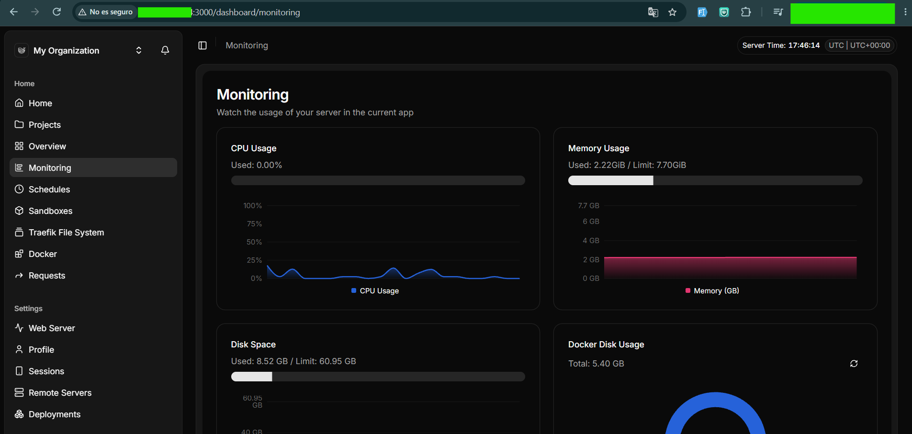
>
> *Qué debe verse:* el panel abierto en `https://dokploy.<tu-dominio>` con candado válido.

5. **Cierra el puerto 3000.** En Azure, borra la regla `Allow-Dokploy-3000`
   (**Networking → Network settings**). El panel ya entra por el 443 y no necesita
   el 3000 expuesto.

### 7.3 Crear el proyecto `marketplace`

En Dokploy, un **proyecto** agrupa los servicios de una misma aplicación. Va a
contener un solo servicio: el Compose del paso siguiente.

1. En el menú lateral, entra a **Projects**.

2. Pulsa **Create Project** (o **+ Project**).
3. Completa:
   - **Name:** `marketplace`
   - **Description** (opcional): «ECommerce: tienda, admin y API».

4. Pulsa **Create**. El proyecto aparece en la lista, todavía sin servicios.

5. Entra al proyecto. Dokploy crea un entorno por defecto (**production**): ahí va
   el Compose.

**Un nombre, varios lugares** (no se mezclan, pero conviene tenerlos claros):

| Dónde | Nombre |
|---|---|
| Proyecto en Dokploy | `marketplace` |
| Repositorio en GitHub | tu fork, `<tu-usuario>/safari-marketplace` |
| Imágenes en Docker Hub | `<usuario>/safari-api`, `safari-shop`, `safari-admin`, `safari-db-init` y `safari-proxy` |
| Dominios | `tienda.<tu-dominio>` y `admin.<tu-dominio>` |

### 7.4 Crear el Compose `safari`

El **Compose** es el servicio que levanta todo el stack a partir del archivo
`docker-compose.deploy.yml` de tu fork. Dokploy clona el repositorio en cada
despliegue y ejecuta ese archivo.

1. Dentro del proyecto `marketplace`, en el entorno **production**, pulsa
   **Create Service** y elige **Compose**.

2. Completa el formulario:
   - **Name:** `safari`
   - **App Name:** déjalo como lo propone Dokploy. Es el nombre interno del stack
     en el servidor (y de su red). Dokploy le agrega un sufijo al final, por
     ejemplo `marketplace-safari-t14qck`.
   - **Compose Type:** **Docker Compose** (no *Stack*).

   Pulsa **Create**.

#### Conectar el repositorio

3. En la pestaña **General**, sección del proveedor, elige **Git**. Como el fork
   es público, no hace falta conectar tu cuenta de GitHub:
   - **Repository URL:** `https://github.com/<tu-usuario>/safari-marketplace.git`
   - **Branch:** `main`
   - **Compose Path:** `./docker-compose.deploy.yml`

   Pulsa **Save**.

> **📷 EVIDENCIA 30 — Compose conectado a tu fork**
>
> 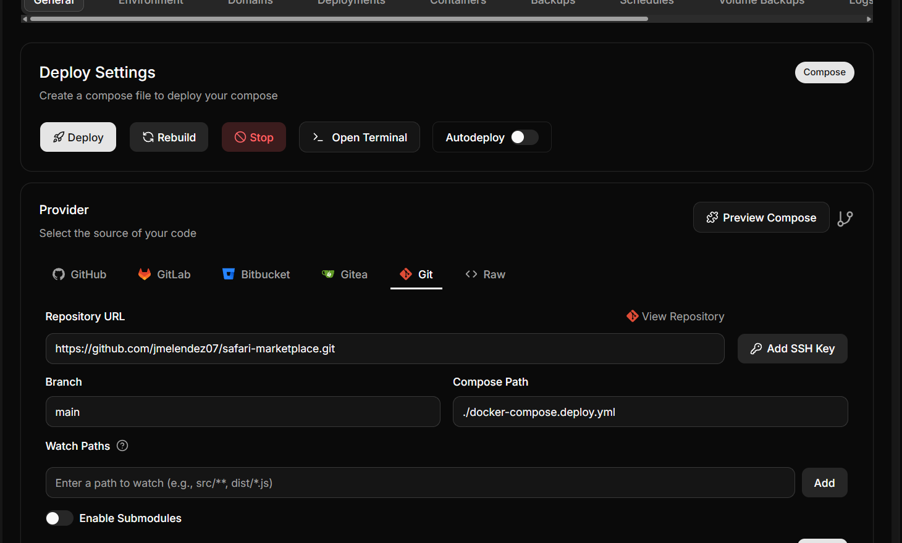
>
> *Qué debe verse:* la URL de tu fork, la rama `main` y el archivo `./docker-compose.deploy.yml`.

> No uses el `docker-compose.yml` de la raíz: es el de desarrollo. Construye las
> imágenes, publica puertos y trae valores de prueba.

4. **Auto Deploy:** déjalo **apagado** (en la misma pestaña **General**).
   Despliegas tú, eligiendo la versión (`IMAGE_TAG`).

Todavía **no despliegues**: sin las variables del paso siguiente, el Compose falla
al arrancar con un mensaje que nombra la variable que falta.

### 7.5 Cargar las variables

El compose de despliegue no trae ningún valor propio del entorno: todos salen de
las variables de esta pestaña. Dokploy las guarda en un archivo `.env` junto a
`docker-compose.deploy.yml`, y el compose las lee con `${VARIABLE}`.

#### Preparar los valores

1. Genera tres cadenas aleatorias, en la VM o en tu equipo. Ejecuta el comando una
   vez por cada una:

   ```bash
   openssl rand -hex 32
   ```

   Usa una para `JWT_SECRET`, otra para `SHOP_SECRET` y la tercera para
   `POSTGRES_PASSWORD`. El resultado es hexadecimal (solo letras y números), así
   que sirve también como contraseña de Postgres.

2. Copia el contenido de `deploy.variables.example` (está en la raíz del
   repositorio) y **cambia todos los valores**:

   ```bash
   # Variables del Compose de despliegue (docker-compose.deploy.yml).
   DOCKERHUB_USERNAME=tu-usuario-de-docker-hub
   IMAGE_TAG=sha-1234567
   SHOP_URL=https://tienda.tu-dominio.com
   JWT_SECRET=cambia-esto-por-una-cadena-aleatoria
   SHOP_SECRET=cambia-esto-por-otra-cadena-aleatoria
   POSTGRES_PASSWORD=cambia-esto-solo-letras-y-numeros
   ```

   | Variable | Valor |
   |---|---|
   | `DOCKERHUB_USERNAME` | tu usuario de Docker Hub |
   | `IMAGE_TAG` | la etiqueta de la fase 1, por ejemplo `sha-4fcb7f1` |
   | `SHOP_URL` | `https://tienda.<tu-dominio>`, con `https` y **sin `/` final** |
   | `JWT_SECRET` | la primera cadena aleatoria |
   | `SHOP_SECRET` | la segunda, distinta de la anterior |
   | `POSTGRES_PASSWORD` | la tercera: **solo letras y números** |

   **Ejemplo** con valores ficticios (usuario `ana-dev`, dominio `ana-lab.dev`):

   ```bash
   DOCKERHUB_USERNAME=ana-dev
   IMAGE_TAG=sha-4fcb7f1
   SHOP_URL=https://tienda.ana-lab.dev
   JWT_SECRET=bc70ab973f4f74138b6d913f9ed34903e313d28a2d9f8ba901297d0bf3a44d11
   SHOP_SECRET=384c8dd1842f20216c5684119a697973996295072645fa5a5df8b94259caace5
   POSTGRES_PASSWORD=176e9ba6b7757b75f677816a6d9705c2d32074318b8f963347dacab50cf9e1af
   ```

   > **No copies los tres secretos del ejemplo:** están publicados aquí, así que
   > cualquiera los conoce. Genera los tuyos con `openssl rand -hex 32`.

   Las líneas que empiezan con `#` son comentarios: puedes dejarlas o borrarlas.

#### Cargarlos en Dokploy

3. En el Compose `safari`, entra a la pestaña **Environment**.

   El editor oculta los valores. El botón del ojo, arriba a la derecha, los muestra
   y los vuelve a ocultar: déjalos ocultos si compartes pantalla.

4. Pega las variables en el editor y pulsa **Save**. Deja encendido
   **Create Environment File**: es lo que escribe el `.env` que lee el compose. Si
   lo apagas, Dokploy ignora estas variables y el despliegue falla.

> **📷 EVIDENCIA 31 — Variables cargadas y guardadas**
>
> 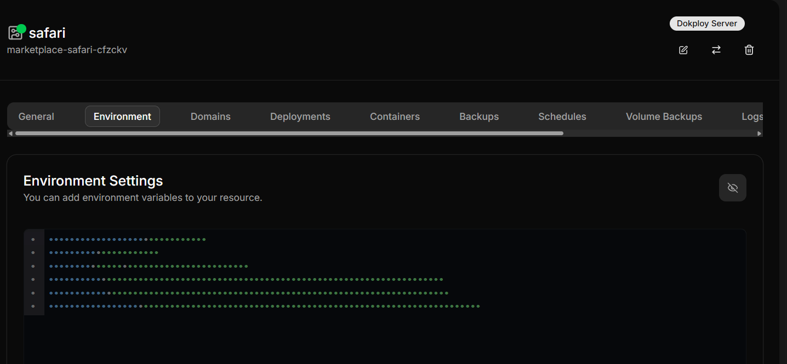
>
> *Qué debe verse:* las seis variables y **Create Environment File** activo. **Tapa los secretos.**

#### Cuidado con estos valores

- **`POSTGRES_PASSWORD` solo se aplica al crear la base.** Si la cambias después,
  la API ya no podrá conectarse. Sin símbolos, porque `@ : / # ?` rompen la URL de
  conexión.
- **Cambiar `JWT_SECRET`** cierra la sesión de todos los usuarios.
- **Si falta una variable**, el despliegue falla al empezar y el log dice cuál
  (`Falta JWT_SECRET …`).

### 7.6 Configurar los dominios

Safari se publica con **dos dominios**, los dos hacia el servicio **`proxy`** del
compose, cada uno con su puerto. El `proxy` (Caddy) reparte después cada petición:

```text
https://tienda.<tu-dominio> ──▶ Traefik ──▶ proxy:3003 ─┬─▶ shop:3000
                                                        └─ /backend/* ─▶ api-lb ─▶ api
https://admin.<tu-dominio>  ──▶ Traefik ──▶ proxy:3002 ─┬─▶ admin:3000
                                                        └─ /backend/* ─▶ api-lb ─▶ api
```

**No crees un dominio para la API.** El navegador le habla por `/backend/…` dentro
del mismo dominio de la tienda o del admin.

> Antes de seguir, los registros DNS `tienda` y `admin` tienen que resolver ya a la
> IP de la VM. Si no, Let's Encrypt no puede emitir los certificados.

#### Dominio de la tienda

1. En el Compose `safari`, entra a la pestaña **Domains** y pulsa **Add Domain**.

2. Si el formulario muestra **«Services not found»** y la lista **Service Name**
   está vacía, pulsa el botón de **refrescar** (↻) que está al lado. Dokploy
   descarga el `docker-compose.deploy.yml` del fork y llena la lista con sus
   servicios.

3. Completa el formulario:

   | Campo | Valor |
   |---|---|
   | Service Name | `proxy` |
   | Host | `tienda.<tu-dominio>` |
   | Path | `/` |
   | Internal Path | `/` |
   | Strip Path | apagado |
   | Container Port | `3003` |
   | Custom Entrypoint | apagado |
   | HTTPS | activado |
   | Certificate Provider | Let's Encrypt |
   | Middlewares | vacío |

   El campo **Certificate Provider** aparece recién al activar **HTTPS**, debajo
   del interruptor. Pulsa **Create**.

#### Dominio del admin

4. Pulsa otra vez **Add Domain** y completa el formulario. Cambian solo **Host** y
   **Container Port**:

   | Campo | Valor |
   |---|---|
   | Service Name | `proxy` |
   | Host | **`admin.<tu-dominio>`** |
   | Path | `/` |
   | Internal Path | `/` |
   | Strip Path | apagado |
   | Container Port | **`3002`** |
   | Custom Entrypoint | apagado |
   | HTTPS | activado |
   | Certificate Provider | Let's Encrypt |
   | Middlewares | vacío |

   Pulsa **Create**.

5. La pestaña **Domains** muestra los dos dominios. El botón **Validate DNS** de
   cada uno comprueba que el registro ya apunta a la IP del servidor.

> **📷 EVIDENCIA 32 — Pestaña Domains con tienda y admin**
>
> 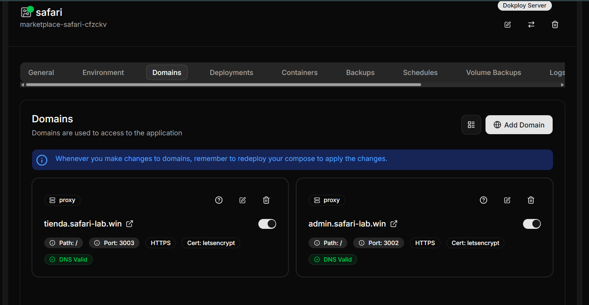
>
> *Qué debe verse:* los dos dominios configurados y la validación DNS correcta.

#### Qué hace Dokploy con esto

- **Los dominios se aplican al desplegar.** Dokploy agrega las etiquetas de Traefik
  al compose en cada despliegue, así que todavía no responden: lo harán después del
  despliegue.
- **HTTP redirige a HTTPS.** Con HTTPS activado, Dokploy crea también la
  redirección desde `http://`.
- **El certificado tarda unos segundos** después del primer despliegue. Mientras
  tanto, el navegador puede mostrar un aviso.

Si quieres ver el compose final que va a ejecutar Dokploy, con las etiquetas de
Traefik y la red ya añadidas, pulsa **Preview Compose** (pestaña **General**).

### 7.7 Desplegar

1. En la pestaña **General** del Compose `safari`, pulsa **Deploy** y confirma.

2. Entra a la pestaña **Deployments**. El despliegue aparece arriba de la lista;
   pulsa **View** para ver su log en vivo.

3. El primer arranque tarda unos minutos: baja las cinco imágenes y crea la base.
   El orden es:

   ```text
   postgres (sano) ─▶ db-init (termina) ─▶ api (sana) ─┬─▶ shop  ─┬─▶ proxy
                                                       └─▶ admin ─┘
   ```

   `api-lb` arranca en paralelo. El despliegue terminó bien cuando el log cierra
   sin errores y la lista marca el despliegue como **Done**.

> **📷 EVIDENCIA 33 — Despliegue terminado en «Done»**
>
> 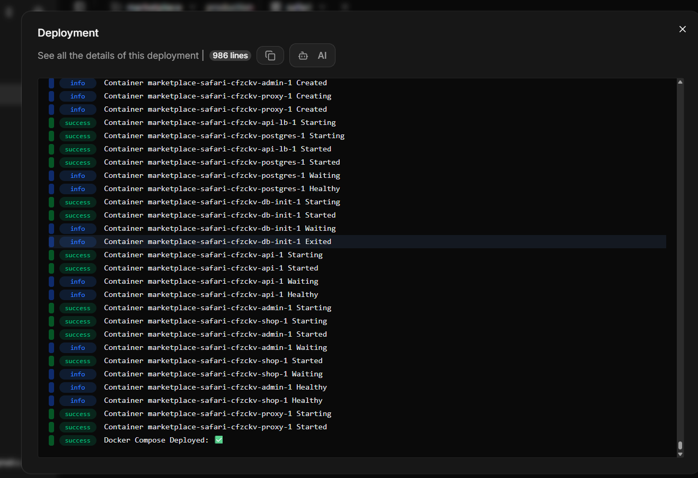
>
> *Qué debe verse:* el final del log y el despliegue en estado **Done**.

4. En la pestaña **Containers**, todos deben estar **running**, salvo `db-init`,
   que termina después de preparar la base (**exited**, con código 0). Es lo
   esperado.

> **📷 EVIDENCIA 34 — Containers con los servicios running**
>
> 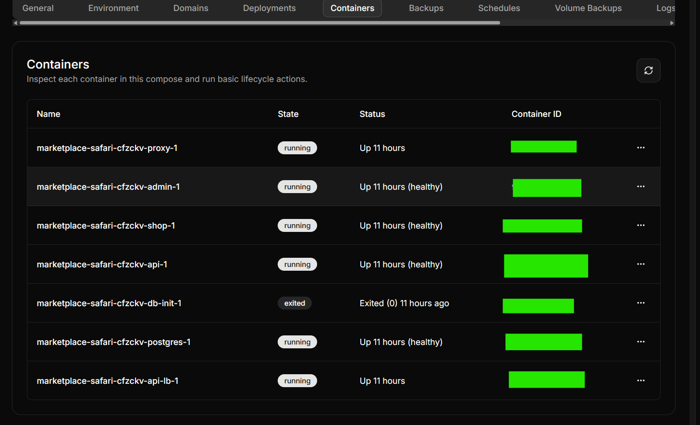
>
> *Qué debe verse:* los contenedores en ejecución y `db-init` terminado con código 0.

5. En la pestaña **Logs**, elige el contenedor `db-init`. En el primer despliegue
   aparece:

   ```text
   db-init: base vacía, seed aplicado
   db-init: esquema al día
   ```

En los despliegues siguientes dice `la base ya tiene datos …, seed omitido`. Los
datos iniciales se cargan **solo una vez**, y lo que crees o borres después no
se pisa.

6. Espera unos segundos a que Traefik emita los certificados de Let's Encrypt.

### 7.8 Comprobar que funciona

Desde tu equipo:

```bash
# La tienda, el admin y la API (por el proxy). Los tres deben dar 200.
curl -sI https://tienda.<tu-dominio>/en | head -1
curl -sI https://admin.<tu-dominio>/en/login | head -1
curl -s  https://tienda.<tu-dominio>/backend/health/ready

# Qué versión corre: «revision» debe ser el commit completo de IMAGE_TAG.
curl -s https://tienda.<tu-dominio>/backend/health

# El sitemap usa tu dominio real.
curl -s https://tienda.<tu-dominio>/robots.txt | grep -i sitemap
```

Salidas esperadas (los valores cambian):

```text
HTTP/2 200
HTTP/2 200
{"status":"ok","database":"up"}

{"status":"ok","instance":"c413bd18b795","revision":"4fcb7f1..."}

Sitemap: https://tienda.<tu-dominio>/sitemap.xml
```

> **📷 EVIDENCIA 35 — Salida de los `curl`**
>
> 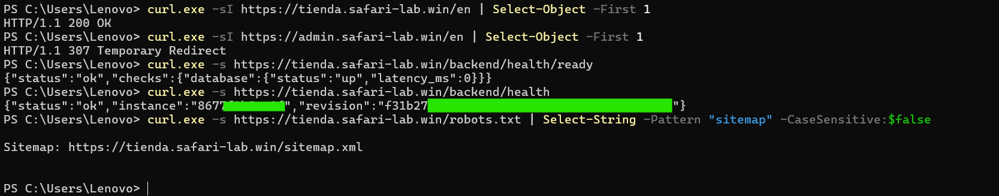
>
> *Qué debe verse:* los `200`, `database: up`, la revisión y el sitemap con tu dominio.

Después, en el navegador:

- `https://tienda.<tu-dominio>` muestra productos.

> **📷 EVIDENCIA 36 — La tienda con productos en su dominio**
>
> 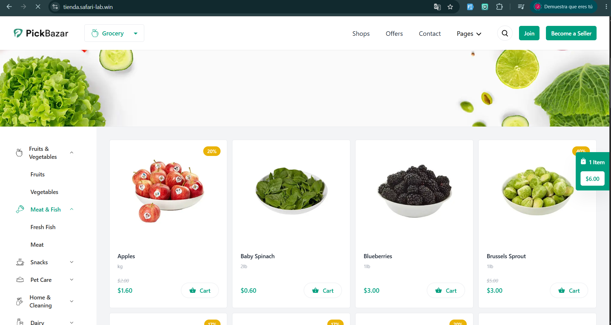
>
> *Qué debe verse:* el catálogo cargado y la URL con tu dominio.

- `https://admin.<tu-dominio>` permite entrar con `admin@demo.com` y la contraseña
  demo, que cambias en el paso siguiente.

- El candado del navegador muestra un certificado válido de Let's Encrypt.

> **📷 EVIDENCIA 37 — Certificado de Let's Encrypt**
>
> 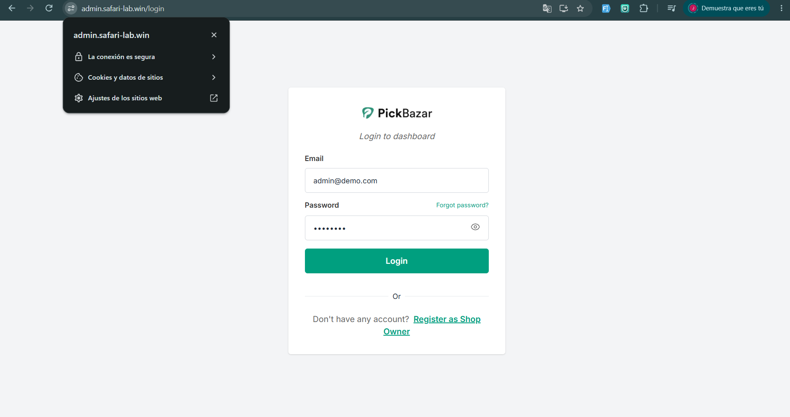
>
> *Qué debe verse:* el candado y el certificado emitido por Let's Encrypt para tu dominio.

Si algo no responde, revisa la sección 8.4.

### 7.9 Cambiar las contraseñas demo (obligatorio)

Los datos iniciales traen cinco usuarios con la **misma contraseña pública**,
`demodemo`, que figura en este repositorio. Con el admin en internet, cualquiera
podría entrar. **Cámbialas apenas termine el primer despliegue.**

| Usuario | Rol |
|---|---|
| `admin@demo.com` | super_admin |
| `store_owner@demo.com` | store_owner |
| `customer@demo.com` | customer |
| `customer2@demo.com` | customer |
| `customer3@demo.com` | customer |

Desde tu equipo, cambia `<tu-dominio>`. El script pregunta la contraseña **actual**
(Enter si todavía es `demodemo`) y la nueva:

```bash
TIENDA=https://tienda.<tu-dominio>
for USUARIO in admin@demo.com store_owner@demo.com customer@demo.com customer2@demo.com customer3@demo.com; do
  read -rsp "Contraseña actual de $USUARIO [demodemo]: " ACTUAL; echo
  ACTUAL=${ACTUAL:-demodemo}
  read -rsp "Contraseña nueva para $USUARIO: " NUEVA; echo

  TOKEN=$(curl -s -X POST "$TIENDA/backend/token" -H 'Content-Type: application/json' \
    -d "{\"email\":\"$USUARIO\",\"password\":\"$ACTUAL\"}" \
    | sed -n 's/.*"token":"\([^"]*\)".*/\1/p')

  if [ -z "$TOKEN" ]; then
    echo "$USUARIO: contraseña actual incorrecta, no se cambió nada"
    continue
  fi

  RESPUESTA=$(curl -s -X POST "$TIENDA/backend/change-password" \
    -H 'Content-Type: application/json' -H "Authorization: Bearer $TOKEN" \
    -d "{\"oldPassword\":\"$ACTUAL\",\"newPassword\":\"$NUEVA\"}")

  case "$RESPUESTA" in
    *'"success":true'*) echo "$USUARIO: contraseña cambiada" ;;
    *) echo "$USUARIO: NO se cambió — $RESPUESTA" ;;
  esac
done
```

Cada usuario debe terminar en «contraseña cambiada». Guarda las contraseñas nuevas
en tu hoja de datos.

> **Si ya cambiaste una contraseña**, escribe la nueva en «Contraseña actual».
> El `401` significa que el login falló porque `demodemo` ya no es válida; no es
> que la contraseña nueva esté mal. `demodemo` solo funciona la primera vez.

Comprueba que `demodemo` ya no sirve:

```bash
curl -s -o /dev/null -w "%{http_code}\n" -X POST "$TIENDA/backend/token" \
  -H 'Content-Type: application/json' -d '{"email":"admin@demo.com","password":"demodemo"}'
```

Debe devolver `401`. Las contraseñas nuevas se guardan en la base y los despliegues
siguientes no las tocan, porque el seed no se vuelve a aplicar.

> **📷 EVIDENCIA 38 — Contraseñas demo cambiadas y `demodemo` rechazada**
>
> 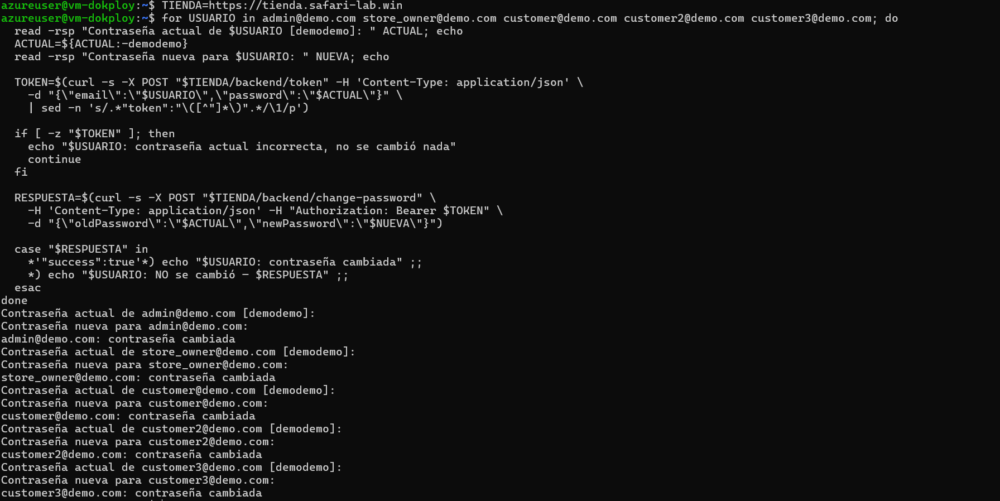
>
> *Qué debe verse:* el cambio exitoso de las cinco cuentas y el `401` al reintentar con `demodemo`. **Tapa las contraseñas.**

> Si alguna contraseña demo sigue funcionando, repite el script para ese usuario.
> No dejes el admin público con `demodemo`.

---

## 8. Fase 6. Operar, actualizar y cerrar

### 8.1 Publicar una versión nueva

1. Haz push a `main` de tu fork (o **Sync fork → Update branch**) y espera la
   corrida verde.
2. Toma la etiqueta nueva del resumen **«Imágenes (sha-…)»**.

3. En Dokploy, cambia `IMAGE_TAG` en **Environment** y pulsa **Deploy**.

4. Comprueba la versión que quedó corriendo:

   ```bash
   curl -s https://tienda.<tu-dominio>/backend/health
   ```

   El campo `revision` debe ser el commit completo de la etiqueta nueva.

> **📷 EVIDENCIA 39 — `/backend/health` con la revisión nueva**
>
> 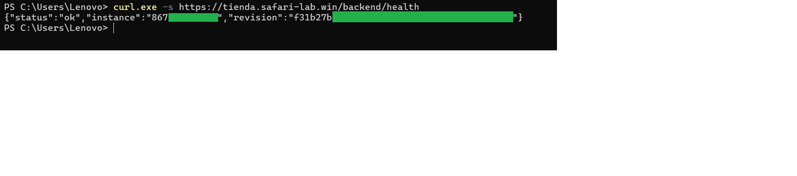
>
> *Qué debe verse:* `revision` con el commit desplegado.

### 8.2 Volver atrás (rollback)

Es lo mismo, con la etiqueta de una versión anterior. Como la base
(`safari-db-init`) y el proxy (`safari-proxy`) van en imágenes con la misma
etiqueta, también vuelve su configuración.

1. En Dokploy, **Environment** → cambia `IMAGE_TAG` por la etiqueta anterior.
2. Pulsa **Deploy**.
3. Verifica con `/backend/health` que `revision` es el commit anterior.

> Dokploy clona `main` en cada despliegue. Lo que sale del repositorio es solo
> `docker-compose.deploy.yml`. Si ese archivo cambió entre las dos versiones, al
> volver atrás se usa el actual.

### 8.3 Limitaciones conocidas

- **Corte de 1 a 2 minutos en cada despliegue.** Se recrean la API, la tienda y el
  admin, y las primeras visitas son lentas mientras la tienda regenera sus
  páginas.
- **No hay migraciones de base.** El esquema se aplica con
  `CREATE ... IF NOT EXISTS`: una tabla nueva sí llega, pero una **columna nueva
  en una tabla existente no**. Si un cambio del esquema la necesita, hay que
  aplicarla a mano o empezar con una base nueva (se pierden los datos).
- **`og:url`** (la URL de las vistas previas en redes sociales) no usa tu dominio:
  queda fija en el build.
- **Sin copias de seguridad ni monitoreo.** Los datos viven en el volumen
  `postgres-data` del VPS.
- **Imágenes de productos:** solo se optimizan las de los hosts permitidos en
  `apps/shop/next.config.js` (`images.remotePatterns`). Las fotos del seed sí lo
  están.
- **La primera visita a `/become-seller` después de cada despliegue da 404** y la
  siguiente ya responde bien: es una página que no se puede armar sin la API.

### 8.4 Problemas frecuentes (todas las fases)

| Síntoma | Causa probable | Qué hacer |
|---|---|---|
| El despliegue falla con `required variable … is missing a value: Falta …` | Falta esa variable o está vacía | Complétala en **Environment** y vuelve a desplegar |
| `pull access denied` o `manifest unknown` | `DOCKERHUB_USERNAME` o `IMAGE_TAG` mal escritos, o esa versión no se publicó | Compara con el resumen «Imágenes (sha-…)»; el `IMAGE_TAG` lleva `sha-` |
| `exec format error` | El VPS es ARM | Usa un VPS x86_64 |
| El dominio da 404 de Traefik | El dominio no apunta a `proxy` con el puerto correcto, o el DNS no resuelve | Revisa la tabla de dominios y `nslookup` |
| Certificado inválido o «no seguro» | Let's Encrypt aún no emitió, o Cloudflare está en modo proxy | Espera un minuto; con Cloudflare, deja el registro en **DNS only** |
| La API queda `unhealthy` tras cambiar `POSTGRES_PASSWORD` | La contraseña solo se aplica al crear el volumen | Vuelve a la contraseña original |
| `db-init` termina con error | Un cambio de esquema que no se aplicó | Ver «No hay migraciones»; revisa su log |
| El login del admin redirige a `http://` | `SHOP_URL` sin `https://` | Corrige `SHOP_URL` y vuelve a desplegar |
| `Validate DNS` falla | El registro no existe o aún no propagó | Espera y vuelve a probar con `nslookup … 1.1.1.1` |
| La tienda abre pero el catálogo está vacío | La API no está sana o `db-init` falló | Revisa **Containers** y los logs de `api` y `db-init` |
| `502` o `503` en `/backend` | Ninguna réplica de la API responde | Revisa el contenedor `api` y su healthcheck |
| El panel de Dokploy no abre por el 3000 | La regla se cerró o el panel ya escucha en 443 | Entra por `https://dokploy.<tu-dominio>` |
| No puedo entrar por SSH | Llave o usuario equivocados, o puerto 22 cerrado | Usuario `azureuser`, llave `.pem`, regla 22 |
| `nslookup` devuelve IPs de Cloudflare | El registro está en **Proxied** | Cámbialo a **DNS only** |
| El CI no publica y el resumen avisa de `DOCKERHUB_USERNAME` | Falta la variable en el fork | Créala y relanza con **Run workflow** |
| `unauthorized` al publicar en Docker Hub | Token vencido, revocado o de solo lectura | Genera uno con **Repo Read & Write** y reemplaza el secreto |

### 8.5 Costos, apagado y borrado

La VM consume crédito **por hora mientras está encendida**, y el disco y la IP
pública consumen **aunque la VM esté detenida**. Con USD 100 alcanza para el curso
si no dejas recursos olvidados.

**Ver cuánto crédito queda:**

- Saldo de Azure for Students: https://www.microsoftazuresponsorships.com.
- Gasto por recurso: **Cost Management → Cost analysis**, filtrando por
  `rg-safari`.

> **📷 EVIDENCIA 40 — Cost analysis del grupo `rg-safari`**
>
> 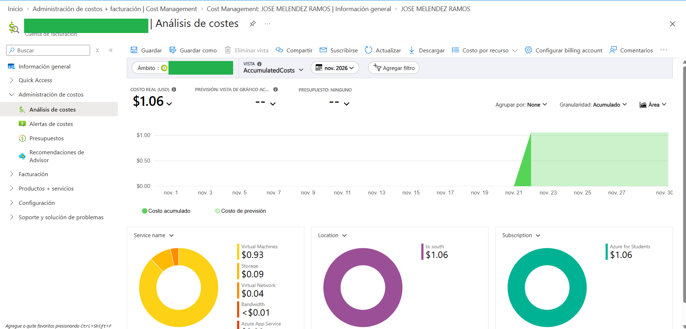
>
> *Qué debe verse:* el gasto del grupo de recursos. **Tapa el Subscription ID.**

**Detener la VM cuando no la uses:**

En la VM, pulsa **Stop**. El estado debe pasar a **Stopped (deallocated)**: así
deja de cobrar el cómputo. Si dice solo **Stopped**, se sigue cobrando.

- La **IP pública no cambia** al volver a arrancar (es estática), así que el DNS y
  Dokploy siguen funcionando.
- Mientras está detenida, **la tienda y el admin no responden**. Si alguien tiene
  que revisar tu despliegue, déjala encendida.
- Para volver: **Start**. Dokploy y el stack arrancan solos con la VM.

**Borrar todo al terminar el curso:**

Borra el **grupo de recursos** completo: se lleva la VM, el disco, la IP y la red
de una vez, y no queda nada consumiendo crédito.

1. En el portal, busca **Resource groups** y abre `rg-safari`.
2. Pulsa **Delete resource group**, escribe `rg-safari` para confirmar y pulsa
   **Delete**.

> **Borrar no tiene vuelta atrás:** se pierden la base de datos y todo lo que haya
> en la VM. Si quieres conservar algo, sácalo antes.

### 8.6 Opcional: proxy y SSL de Cloudflare

**Hazlo solo cuando el despliegue ya funcione con HTTPS en DNS only.**

Con **Proxied**, el tráfico pasa primero por Cloudflare y después llega a tu VM:

```text
navegador ──https──▶ Cloudflare ──https──▶ tu VM (Traefik)
```

- **A favor:** la IP de tu VM queda oculta, Cloudflare filtra parte del tráfico
  malicioso y cachea contenido estático.
- **En contra:** agrega una pieza más entre el navegador y tu servidor. Si algo
  falla, cuesta más saber dónde. Por eso la guía empieza con **DNS only**.

1. En tu dominio, entra a **SSL/TLS → Overview** y elige **Full (strict)**.

   - **Full (strict):** Cloudflare habla HTTPS con tu VM y exige un certificado
     válido. Ya lo tienes: el de Let's Encrypt que emitió Dokploy.
   - **No uses «Flexible»:** Cloudflare hablaría HTTP con tu VM y Traefik lo
     redirigiría a HTTPS, produciendo un bucle de redirecciones
     (`ERR_TOO_MANY_REDIRECTS`).

2. En **DNS → Records**, edita `tienda` y `admin` y activa **Proxy status** (nube
   naranja).

3. Comprueba que la tienda y el admin siguen abriendo con HTTPS.

Deja `dokploy` en **DNS only**. El panel lo usas solo tú y así no depende de
Cloudflare.

**Para volver atrás:** apaga el **Proxy status** de los registros (vuelven a **DNS
only**). El modo SSL/TLS solo se aplica al tráfico que pasa por el proxy, así que
puede quedar como está.

---

## Apéndices

### A. Checklist final de aceptación

Marca cada punto con evidencia real, no con «creo que sí».

| # | Criterio | Cómo comprobarlo | Evidencia |
|---|---|---|---|
| 1 | Fork público con Actions habilitado | Pestaña Actions sin avisos de workflows deshabilitados | 01–05 |
| 2 | Secreto y variable de Docker Hub | `gh secret list` y `gh variable list`, o la lista en GitHub | 14–19 |
| 3 | CI publica las cinco imágenes | Job **build y publicación** verde y resumen `Imágenes (sha-…)` | 20–21 |
| 4 | `IMAGE_TAG` anotado | Hoja de datos | 21 |
| 5 | Dominio comprado en Cloudflare | Panel de Cloudflare con el dominio | 23 |
| 6 | Cuenta con 2FA | My Profile → Authentication | 22 |
| 7 | VM x86_64 con 4 GB y 64 GB | Overview de la VM y `uname -m`, `free -h`, `df -h` | 24, 26 |
| 8 | Puertos 22/80/443 abiertos y 3000 abierto al instalar | Network settings | 25 |
| 9 | SSH con `azureuser` funciona | Prompt `azureuser@vm-dokploy` | 26 |
| 10 | Tres subdominios resuelven a la IP | Registros DNS y `nslookup …` | 27–28 |
| 11 | Dokploy instalado y panel con HTTPS | `https://dokploy.<tu-dominio>` con candado | 29 |
| 12 | Proyecto y Compose conectados al fork | Pestaña General con URL, rama y path | 30 |
| 13 | Variables cargadas y `Create Environment File` activo | Pestaña Environment | 31 |
| 14 | Dos dominios a `proxy` con puertos 3003 y 3002 | Pestaña Domains | 32 |
| 15 | Despliegue **Done** y contenedores sanos | Deployments y Containers | 33–34 |
| 16 | Tienda y admin responden 200 | `curl -sI` | 35 |
| 17 | Certificado válido de Let's Encrypt | Candado del navegador | 37 |
| 18 | Contraseñas demo cambiadas y `demodemo` rechazada | Script y `401` | 38 |
| 19 | Actualización probada y rollback documentado | `/backend/health` con dos revisiones | 39 |
| 20 | Crédito y borrado bajo control | Cost analysis y estado de la VM | 40 |

### B. Hoja de datos final

| Dato | Tu valor |
|---|---|
| Usuario de GitHub | |
| Usuario de Docker Hub | |
| `IMAGE_TAG` desplegado | |
| Dominio | |
| IP pública de la VM | |
| Ruta de la llave SSH | |
| Correo del panel de Dokploy | |
| Contraseña del panel de Dokploy | |
| Contraseña nueva de `admin@demo.com` | |
| Contraseña nueva de `store_owner@demo.com` | |
| Contraseña nueva de los clientes demo | |
| Fecha de vencimiento del dominio | |
| Crédito de Azure restante | |

Guarda esta hoja en un gestor de contraseñas, **no** en el repositorio.

### C. Comandos de referencia

**Comprobar el equipo:**

```bash
ssh -V
curl --version
nslookup localhost
openssl version
```

**GitHub CLI:**

```bash
gh auth status
gh secret list --repo <tu-usuario>/safari-marketplace
gh variable list --repo <tu-usuario>/safari-marketplace
gh workflow run ci.yml --ref main --repo <tu-usuario>/safari-marketplace
gh run list --repo <tu-usuario>/safari-marketplace --limit 3
```

**SSH:**

```bash
ssh -i ~/.ssh/vm-dokploy-key.pem azureuser@<IP-de-la-VM>
uname -m
free -h
df -h /
```

**DNS:**

```bash
nslookup tienda.<tu-dominio>
nslookup admin.<tu-dominio>
nslookup dokploy.<tu-dominio>
nslookup tienda.<tu-dominio> 1.1.1.1
dig +short tienda.<tu-dominio>
```

**Secretos:**

```bash
openssl rand -hex 32
```

**Dokploy:**

```bash
curl -sSL https://dokploy.com/install.sh | sudo sh
```

**Comprobar el despliegue:**

```bash
curl -sI https://tienda.<tu-dominio>/en | head -1
curl -sI https://admin.<tu-dominio>/en/login | head -1
curl -s  https://tienda.<tu-dominio>/backend/health/ready
curl -s  https://tienda.<tu-dominio>/backend/health
curl -s  https://tienda.<tu-dominio>/robots.txt | grep -i sitemap
```

**Docker en la VM (opcional, para diagnóstico):**

```bash
docker ps
docker compose ls
docker logs <nombre-del-contenedor>
docker stats --no-stream
```

### D. Índice de evidencias

Estas son las **40 capturas** que pide la guía. Las primeras 19 ya están en
`img/guia/` (la 06b es un complemento de la 06); las demás van del 20 al 40. La
numeración respeta el orden del documento.

| Nº | Evidencia | Archivo sugerido | Qué debe verse |
|---|---|---|---|
| 01 | Botón «Fork» en el repositorio original | [`01-boton-fork.png`](img/guia/01-boton-fork.png) | la página de `rcuello/safari-marketplace` con el botón **Fork** arriba a la derecha. |
| 02 | Formulario «Create a new fork» | [`02-create-fork.png`](img/guia/02-create-fork.png) | Owner con tu usuario, nombre `safari-marketplace` y «Copy the main branch only» marcado. |
| 03 | El fork recién creado, con «forked from» | [`03-fork-creado.png`](img/guia/03-fork-creado.png) | el nombre de tu repositorio, la marca «forked from rcuello/safari-marketplace» y la rama `main`. |
| 04 | Aviso para habilitar los workflows | [`04-habilitar-actions.png`](img/guia/04-habilitar-actions.png) | la pestaña **Actions** del fork con el botón para habilitar los workflows. |
| 05 | Workflow CI/CD habilitado | [`05-actions-habilitado.png`](img/guia/05-actions-habilitado.png) | el workflow **CI/CD** en la lista lateral de Actions. |
| 06 | Menú «Run workflow» sobre la rama main | [`06-run-workflow.png`](img/guia/06-run-workflow.png) | el desplegable con la rama `main` seleccionada y el botón verde **Run workflow**. |
| 06b | Corrida en curso | [`06-run-workflow-2.png`](img/guia/06-run-workflow-2.png) | la corrida recién creada en estado **In progress**. |
| 07 | Resumen de la primera corrida «solo build» | [`07-primera-corrida.png`](img/guia/07-primera-corrida.png) | la corrida en verde y el aviso de que las imágenes se construyeron sin publicar. |
| 08 | Menú del avatar con «Account settings» | [`08-dockerhub-account-settings.png`](img/guia/08-dockerhub-account-settings.png) | el menú desplegable del avatar con la opción **Account settings**. |
| 09 | Página «Personal access tokens» | [`09-dockerhub-personal-access-tokens.png`](img/guia/09-dockerhub-personal-access-tokens.png) | la lista de tokens y el botón **Generate new token**. |
| 10 | Formulario del token con «Repo Read & Write» | [`10-dockerhub-token-form.png`](img/guia/10-dockerhub-token-form.png) | la descripción, la fecha de expiración y el permiso **Repo Read & Write** seleccionado. |
| 11 | Token generado, con el botón de copiar | [`11-dockerhub-token-generado.png`](img/guia/11-dockerhub-token-generado.png) | el token recién creado y el botón de copiar. **No publiques esta captura sin tapar el token.** |
| 12 | Barra del repositorio con «Settings» | [`12-github-settings.png`](img/guia/12-github-settings.png) | la barra superior del repositorio con la pestaña **Settings**. |
| 13 | Menú «Secrets and variables → Actions» | [`13-github-secrets-variables.png`](img/guia/13-github-secrets-variables.png) | el menú lateral de Settings con esa opción resaltada. |
| 14 | Botón «New repository secret» | [`14-github-new-secret.png`](img/guia/14-github-new-secret.png) | la pestaña **Secrets** con el botón **New repository secret**. |
| 15 | Formulario del secreto `DOCKERHUB_TOKEN` | [`15-github-secret-form.png`](img/guia/15-github-secret-form.png) | el nombre exacto y el campo del valor. **Tapa el token antes de compartir la imagen.** |
| 16 | Secreto creado | [`16-github-secret-creado.png`](img/guia/16-github-secret-creado.png) | `DOCKERHUB_TOKEN` en la lista de secretos, sin valor visible. |
| 17 | Pestaña «Variables» | [`17-github-nueva-variable.png`](img/guia/17-github-nueva-variable.png) | la pestaña **Variables** con el botón **New repository variable**. |
| 18 | Formulario de la variable `DOCKERHUB_USERNAME` | [`18-github-variable-form.png`](img/guia/18-github-variable-form.png) | el nombre exacto y tu usuario de Docker Hub como valor. |
| 19 | Variable creada | [`19-github-variable-creada.png`](img/guia/19-github-variable-creada.png) | `DOCKERHUB_USERNAME` en la lista de variables con su valor. |
| 20 | Corrida con publicación en verde | [`20-publicacion-verde.png`](img/guia/20-publicacion-verde.png) | el job **«Imágenes Docker · build y publicación»** terminado en verde. |
| 21 | Resumen «Imágenes (sha-…)» | [`21-resumen-imagenes.png`](img/guia/21-resumen-imagenes.png) | las cinco imágenes con la misma etiqueta `sha-` y el texto de publicación en tu cuenta. |
| 22 | 2FA activo en Cloudflare | [`22-cloudflare-2fa.png`](img/guia/22-cloudflare-2fa.png) | la confirmación de que la autenticación en dos pasos quedó activa. **No muestres el secreto ni los códigos de recuperación.** |
| 23 | El dominio en tu cuenta de Cloudflare | [`23-cloudflare-dominio.png`](img/guia/23-cloudflare-dominio.png) | tu dominio listado en Cloudflare con estado activo. |
| 24 | VM creada, con su IP pública | [`24-azure-vm-ip.png`](img/guia/24-azure-vm-ip.png) | el estado de la VM y la IP pública. **Tápala antes de compartir la imagen.** |
| 25 | Reglas de entrada 22, 80, 443 y 3000 | [`25-azure-reglas.png`](img/guia/25-azure-reglas.png) | las cuatro reglas de entrada abiertas. |
| 26 | SSH conectado y comprobaciones de la VM | [`26-ssh-vm.png`](img/guia/26-ssh-vm.png) | el prompt `azureuser@vm-dokploy` y la salida de `uname -m`, `free -h` y `df -h`. **Tapa la IP.** |
| 27 | Los tres registros A en Cloudflare | [`27-dns-registros.png`](img/guia/27-dns-registros.png) | `tienda`, `admin` y `dokploy` con la misma IP y la nube gris (DNS only). **Tapa la IP.** |
| 28 | Los tres subdominios resuelven a la VM | [`28-nslookup.png`](img/guia/28-nslookup.png) | la salida de `nslookup` para los tres subdominios, con la IP de tu VM. |
| 29 | Panel de Dokploy en HTTPS | [`29-dokploy-panel.png`](img/guia/29-dokploy-panel.png) | el panel abierto en `https://dokploy.<tu-dominio>` con candado válido. |
| 30 | Compose conectado a tu fork | [`30-dokploy-compose-git.png`](img/guia/30-dokploy-compose-git.png) | la URL de tu fork, la rama `main` y el archivo `./docker-compose.deploy.yml`. |
| 31 | Variables cargadas y guardadas | [`31-dokploy-variables.png`](img/guia/31-dokploy-variables.png) | las seis variables y **Create Environment File** activo. **Tapa los secretos.** |
| 32 | Pestaña Domains con tienda y admin | [`32-dokploy-dominios.png`](img/guia/32-dokploy-dominios.png) | los dos dominios configurados y la validación DNS correcta. |
| 33 | Despliegue terminado en «Done» | [`33-dokploy-deploy-done.png`](img/guia/33-dokploy-deploy-done.png) | el final del log y el despliegue en estado **Done**. |
| 34 | Containers con los servicios running | [`34-dokploy-containers.png`](img/guia/34-dokploy-containers.png) | los contenedores en ejecución y `db-init` terminado con código 0. |
| 35 | Salida de los `curl` | [`35-curl.png`](img/guia/35-curl.png) | los `200`, `database: up`, la revisión y el sitemap con tu dominio. |
| 36 | La tienda con productos en su dominio | [`36-tienda.png`](img/guia/36-tienda.png) | el catálogo cargado y la URL con tu dominio. |
| 37 | Certificado de Let's Encrypt | [`37-certificado.png`](img/guia/37-certificado.png) | el candado y el certificado emitido por Let's Encrypt para tu dominio. |
| 38 | Contraseñas demo cambiadas y `demodemo` rechazada | [`38-contrasenas-demo.png`](img/guia/38-contrasenas-demo.png) | el cambio exitoso de las cinco cuentas y el `401` al reintentar con `demodemo`. **Tapa las contraseñas.** |
| 39 | `/backend/health` con la revisión nueva | [`39-health-revision.png`](img/guia/39-health-revision.png) | `revision` con el commit desplegado. |
| 40 | Cost analysis del grupo `rg-safari` | [`40-cost-analysis.png`](img/guia/40-cost-analysis.png) | el gasto del grupo de recursos. **Tapa el Subscription ID.** |

### E. Glosario

| Término | Significado |
|---|---|
| **API** | El servicio que entrega los datos a la tienda y al admin |
| **Build** | El proceso de convertir código en una imagen o en archivos listos para servir |
| **CI** | Integración Continua: revisar, probar y construir en cada cambio |
| **Caddy** | Proxy del stack que reparte tienda, admin y `/backend` |
| **Compose** | Archivo y servicio de Dokploy que levanta varios contenedores juntos |
| **Contenedor** | Una imagen ejecutándose |
| **Docker Hub** | Registro donde se guardan y descargan las imágenes |
| **Dokploy** | Panel que instala Docker y Traefik y despliega aplicaciones en un VPS |
| **Dominio** | El nombre que compras, por ejemplo `ana-lab.dev` |
| **DNS** | El sistema que traduce nombres a IP |
| **Fork** | Tu copia de un repositorio en tu cuenta |
| **HTTPS** | HTTP cifrado con un certificado |
| **Imagen** | Paquete inmutable con una aplicación y sus dependencias |
| **IP pública** | La dirección de tu VM en internet |
| **Let's Encrypt** | Autoridad que emite certificados gratuitos |
| **`main`** | La rama principal del repositorio |
| **PostgreSQL** | La base de datos del proyecto |
| **Registro A** | Registro DNS que apunta un nombre a una IPv4 |
| **Rollback** | Volver a una versión anterior |
| **SSH** | Protocolo para entrar a un servidor por terminal |
| **Subdominio** | Un nombre delante del dominio, como `tienda` en `tienda.ana-lab.dev` |
| **Tag / etiqueta** | La versión de una imagen. Aquí `sha-<commit>` |
| **Traefik** | Reverse proxy de Dokploy; recibe 80/443 y enruta por dominio |
| **VPS** | Servidor virtual privado |
| **`.pem`** | Archivo de llave privada SSH |
| **`.env`** | Archivo de variables de entorno |

### F. Mapa de fuentes

Esta guía consolida y desarrolla estos documentos del repositorio:

| Sección de esta guía | Documentos originales |
|---|---|
| 1. Fundamentos | `README.md`, `docs/README.md`, `apps/README.md` |
| 2. Equipo y cuentas | `docs/README.md` |
| 3. Fork y CI | `docs/github/README.md`, `01-fork-y-actions.md`, `02-secretos-github-actions.md`, `.github/workflows/ci.yml` |
| 4. Dominio | `docs/cloudflare/README.md`, `01-crear-la-cuenta.md`, `02-comprar-el-dominio.md` |
| 5. VM | `docs/azure/README.md`, `01-activar-azure-for-students.md`, `02-crear-la-vm.md`, `03-abrir-los-puertos.md`, `04-conectarse-por-ssh.md`, `05-costos-y-apagado.md`, `docs/dokploy/02-vps-y-dns.md` |
| 6. DNS | `docs/cloudflare/03-registros-dns.md`, `04-comprobar.md` |
| 7. Dokploy | `docs/dokploy/README.md`, `01` a `09`, `deploy.variables.example`, `docker-compose.deploy.yml` |
| 8. Operar | `docs/dokploy/10-actualizar-y-volver-atras.md`, `11-limitaciones-y-problemas.md`, `docs/azure/05-costos-y-apagado.md`, `docs/cloudflare/05-proxy-y-ssl-opcional.md` |
| Apéndices | Todas las anteriores y `apps/README.md` |

### G. Cómo agregar tus imágenes

1. Crea la carpeta `img/guia/` en la raíz del repositorio.
2. Guarda cada captura pendiente (20–40) con el nombre que aparece en su bloque
   de evidencia. El apéndice D las lista todas.
3. Recorta solo la ventana o el panel relevante. Evita mostrar barras del
   navegador con datos personales.
4. **Tapa siempre:** tokens, contraseñas, correos, códigos de recuperación, IP
   pública, *Subscription ID*, llaves SSH y datos de pago.
5. Si prefieres no capturar todo, prioriza las evidencias del checklist final
   (apéndice A). Son las que demuestran el resultado.
6. Puedes reutilizar capturas que ya existen en `docs/github/img/`,
   `docs/cloudflare/img/` y `docs/dokploy/img/`: cópialas a `img/guia/` con el
   nombre de esta guía, comprobando que coincidan con la versión actual de la
   interfaz.

Formato sugerido: PNG, ancho entre 1200 y 1600 px, con el texto legible.

---

**Fin de la guía.** Si llegaste hasta aquí con las evidencias del apéndice A, tu
fork está publicado, tu dominio resuelve, tu servidor corre Dokploy y tu tienda
abre con HTTPS y contraseñas propias. Guarda la hoja de datos y revisa el crédito
de Azure antes de olvidarte del servidor.
